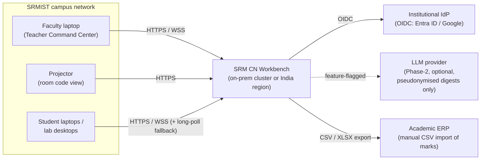
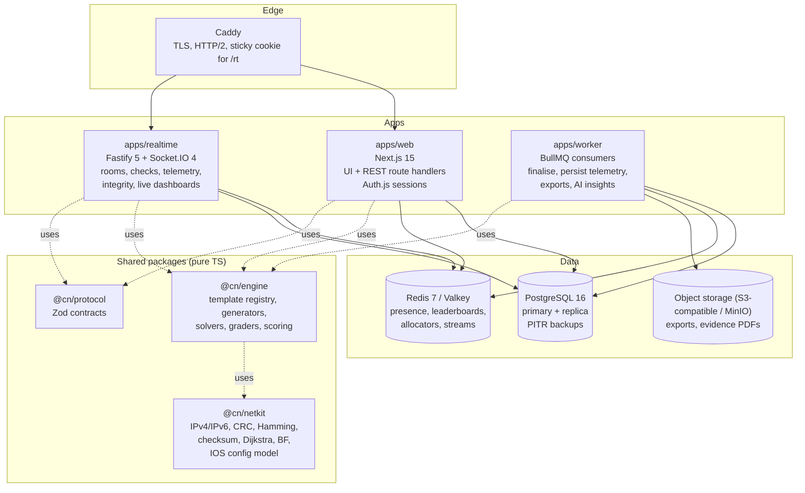
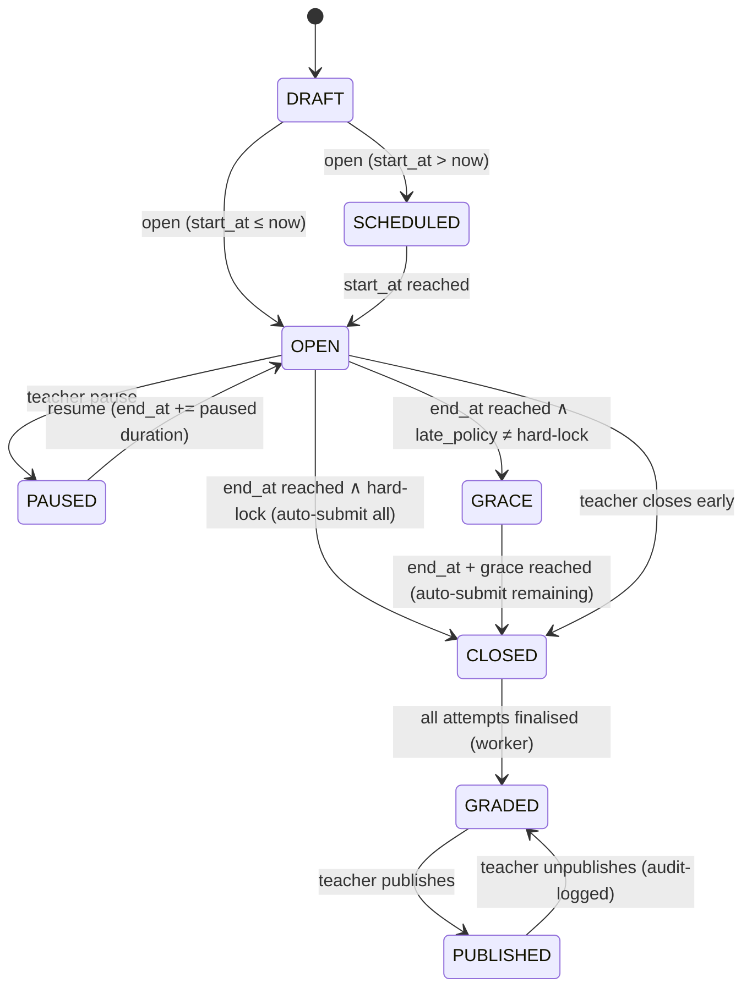
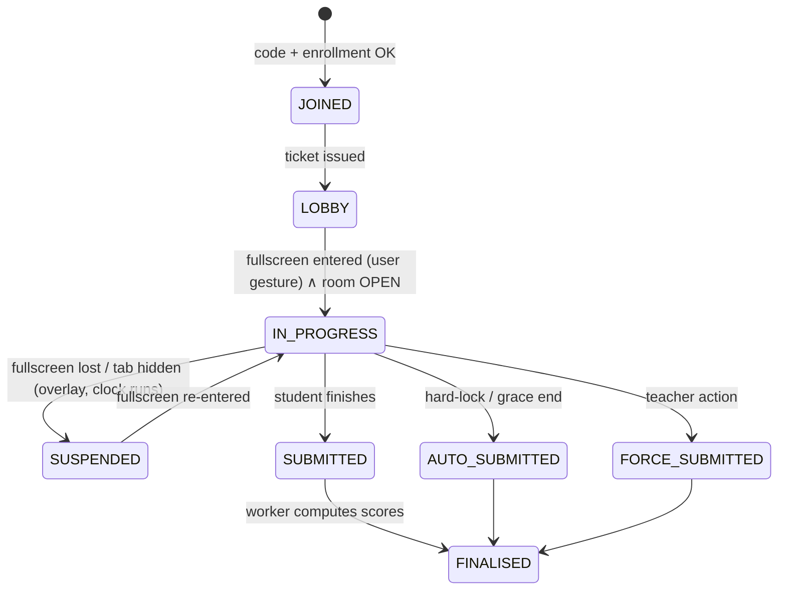
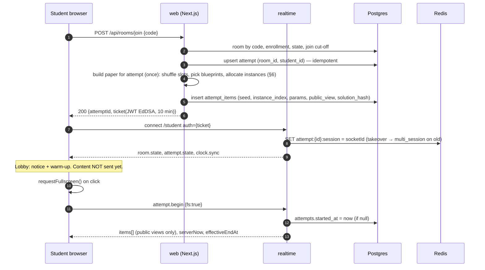
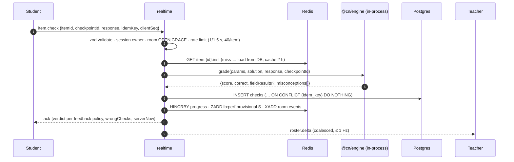

# ARCHITECTURE — SRM CN Workbench

**Status:** v1.0 · 2026-11-19 · Owner: Platform team
**Read with:** [PRD.md](PRD.md) (what and why) · [INTERACTIVE_TEMPLATES_SPEC.md](INTERACTIVE_TEMPLATES_SPEC.md) (template mechanics) · [QUESTION_BANK_SCHEMA.md](QUESTION_BANK_SCHEMA.md) (data contracts)

> **Demo build (2026-11-19):** the implemented v1 is a single Next.js 16 app deployed on Vercel.
> - Upstash Redis holds rooms and attempts, with an in-memory fallback for local runs.
> - Live updates use HTTPS polling instead of Socket.IO, which keeps it reliable on campus Wi‑Fi and mobile data.
> - Identity is by register number plus a per-attempt token, and teachers hold a per-room host key.
> - The deterministic engine (§6), scoring (§10) and data model are implemented as specified here, in `src/engine/`.
> - The Postgres/Socket.IO design below remains the target for an institution-wide rollout.

---

## 1. Decisions at a glance

| Concern | Decision | Why | Rejected |
|---|---|---|---|
| Language | **TypeScript 5.x end-to-end**, Node.js 22 LTS | One language for generators, graders, and UI; the same pure grading code runs in tests, server, and worker | Python grader (two codebases, drift risk) |
| Repo | **pnpm workspaces + Turborepo** | Shared packages (`engine`, `netkit`, `protocol`) with cached builds | Nx (heavier), polyrepo (versioning pain) |
| Web app | **Next.js 15 (App Router) + React 19** | SSR for teacher dashboards, route handlers for REST, mature auth ecosystem | Remix (fine, smaller ecosystem here), SPA-only (worse first load on lab desktops) |
| Styling | **Tailwind CSS v4 with CSS-variable design tokens + Radix UI primitives (unstyled)** | Tokens enforce the design system; Radix gives accessible behaviour without visual opinions | Default shadcn look (banned by DESIGN_SYSTEM), MUI (visual lock-in) |
| Canvases | **@xyflow/react 12** for graphs and topologies; **hand-written SVG** for bit fields, timelines, ladders, cables; **@dnd-kit** for drag-drop; **Motion** for micro-interactions | SVG is crisp at any DPI, accessible (DOM nodes, ARIA), and themeable through tokens; xyflow handles pan/zoom/edges | Konva/Pixi (canvas bitmap: weaker a11y, harder theming), D3-only (rebuilding drag-drop) |
| Template state | **XState v5** machine per template; **Zustand** for workbench shell state | Each template's visual state machine is spec'd, testable, and replayable from telemetry | Ad-hoc `useState` (untestable flows) |
| Realtime | **Socket.IO 4 on a dedicated Fastify 5 service** (`apps/realtime`) with the Redis adapter | Rooms, acks, reconnection, and **HTTP long-polling fallback** for campus proxies that break WebSockets; scales horizontally | Raw `ws` (rebuilding reconnection/rooms), Pusher/Ably (data leaves campus, cost), Next.js route-handler WebSockets (not production-grade) |
| Database | **PostgreSQL 16 + Drizzle ORM** (drizzle-kit migrations) | Relational integrity for rosters and marks, JSONB for instance payloads, native partitioning for telemetry; Drizzle is SQL-transparent and typed | Prisma (heavier runtime, weaker partition/raw-SQL ergonomics), Mongo (weak relational guarantees for marks) |
| Hot state | **Redis 7 / Valkey 8** | Presence TTLs, leaderboards (sorted sets), allocation counters, Socket.IO adapter, telemetry ingest stream | In-process memory (not horizontally scalable) |
| Jobs | **BullMQ** (`apps/worker`) | Attempt finalisation, telemetry batch writes, exports, AI insights | Cron + SQL polling |
| Auth | **Auth.js v5** with an institutional OIDC provider (Entra ID or Google Workspace); **EdDSA room tickets** for the realtime service | SSO with no passwords stored; short-lived scoped tokens across services | Custom auth |
| Validation | **Zod** schemas shared in `@cn/protocol` | One contract for REST, WebSocket events, blueprint JSON, and DB JSONB | Hand-rolled validation |
| Observability | **OpenTelemetry → Grafana (Tempo, Loki, Prometheus)**; GlitchTip for errors | Self-hostable, no student data to third parties | SaaS APM |
| Tests | **Vitest + fast-check** (property tests for generators), **Playwright** (E2E incl. fullscreen flows), **k6** (load) | Determinism and equivalence of generators are the riskiest property; they need property tests, not examples | — |
| Deploy | **Docker images; Compose for dev/pilot; Kubernetes (k3s) for production on-prem**, Caddy at the edge | Runs in the SRMIST datacenter or an India cloud region; no vendor lock-in | Vercel (serverless WebSockets and data-residency constraints) |

## 2. System context



## 3. Containers



**Why a separate realtime service.** Live rooms have different scaling, deploy cadence, and failure semantics from the dashboard and CRUD app. Deploying `web` must never drop 4,000 sockets. `realtime` is deployed with connection draining. Clients reconnect transparently and resume from server state.

## 4. Monorepo layout

```
cn-workbench/
├─ apps/
│  ├─ web/                    # Next.js: teacher + student UI, REST
│  │  ├─ app/(teacher)/…      # dashboard, rooms, live, results
│  │  ├─ app/(student)/…      # join, lobby, workbench, summary
│  │  ├─ app/api/…            # route handlers (REST)
│  │  └─ lib/integrity/       # client sensors (fullscreen, visibility, …)
│  ├─ realtime/               # Fastify + Socket.IO
│  │  ├─ src/namespaces/student.ts
│  │  ├─ src/namespaces/teacher.ts
│  │  ├─ src/services/{check,telemetry,integrity,presence,leaderboard}.ts
│  │  └─ src/auth/ticket.ts
│  └─ worker/                 # BullMQ processors
├─ packages/
│  ├─ engine/                 # @cn/engine — template contract, registry, paper builder, scoring
│  │  └─ src/templates/{pinout,patchbay,encap,delayline,bitbench,slicer,nat,fib,ios,spf,vectors,medium,arq,bitforge,frame,hexdump,ladder}/
│  │       ├─ generate.ts  solve.ts  grade.ts  moves.ts  index.ts  *.prop.test.ts
│  ├─ netkit/                 # @cn/netkit — pure networking math & models
│  ├─ templates-ui/           # @cn/templates-ui — React renderers + XState machines per template
│  ├─ ui/                     # @cn/ui — design-system components and tokens (see DESIGN_SYSTEM.md)
│  ├─ protocol/               # @cn/protocol — Zod schemas: REST, WS events, blueprint JSON
│  ├─ db/                     # @cn/db — Drizzle schema, migrations, seed (syllabus taxonomy)
│  ├─ syllabus/               # course taxonomies as data (21CSC302J.json)
│  ├─ bank/                   # blueprint JSON files (reviewed via PR), validated in CI
│  ├─ insights/               # Phase-2 AI provider interface + implementations
│  └─ config/                 # eslint, tsconfig, tailwind preset
├─ infra/                     # docker, compose, k8s manifests, Caddyfile, otel
└─ docs/                      # these specs
```

**Dependency rule:** `engine` and `netkit` import nothing from React, Node I/O, or the network. They are pure and deterministic, which makes them safe to run in the browser for Studio previews and on the server for grading.

## 5. Runtime flows

### 5.1 Room lifecycle



Clock authority is the realtime service. Transitions are driven by a per-room timer (BullMQ delayed jobs keyed by `room:{id}:transition`, idempotent), **not** by clients.

### 5.2 Attempt lifecycle



### 5.3 Join, ticket, and fullscreen gate



Instances are materialised at join time, not at room creation, so late joiners and room extensions don't need special cases. Materialisation is idempotent: re-joining returns the existing rows.

### 5.4 Check (server-graded try)



The idempotency key makes retried checks (after a reconnect) safe and never double-counted.

### 5.5 Telemetry and integrity ingest

- The client buffers interaction events in memory and IndexedDB. It flushes `telemetry.batch` every 2 s or every 50 events, with a monotonic `seq`.
- **Integrity events are sent immediately** (`integrity.event`, acked) and duplicated into the next batch. On `pagehide`, `navigator.sendBeacon('/api/integrity/beacon')` sends anything unflushed.
- `realtime` appends batches to Redis stream `tele:ingest`. The `worker` consumes with `XREADGROUP` in batches of up to 5,000 and writes to Postgres with `COPY`, using the partitioned table. Sequence gaps are detected per attempt; a gap with a live socket raises `tamper_suspected`.
- A heartbeat every 2 s `{fs, vis, focus, itemId, seq}` feeds presence (TTL 10 s) and reconciliation.

### 5.6 Finalisation

`attempt.finalize` job (idempotent):
1. Load items, checks, telemetry aggregates, and integrity events.
2. Per item: Aᵢ from the final checkpoint states, efficiency (PRD §8.2), and T&E rules (PRD §8.3).
3. Integrity P and I, with excused events removed; late Δ and L.
4. Write `attempts.scores` (full decomposition JSON), `final_S`, `marks`; update leaderboards; mark FINALISED.

Rerunning the job after a teacher override or excuse recomputes deterministically.

## 6. Deterministic per-student parameterisation engine

### 6.1 Seed derivation

```
MASTER_KEY   : 256-bit secret (vault), rotated per academic year (old keys retained for regrading)
roomKey      = HKDF-SHA256(MASTER_KEY, salt = room.id, info = "cnwb/room/v1")
itemSeed     = HMAC-SHA256(roomKey, attempt.id ‖ "|" ‖ slot.index ‖ "|" ‖ blueprint.id ‖ "@" ‖ blueprint.version)[0..16)
```

`itemSeed` (128 bits) is stored on `attempt_items.seed`. Because seeds are keyed by a server secret, students cannot predict or reproduce a classmate's instance even when the generator code is open-source.

### 6.2 PRNG — integer-only and identical on every engine

```ts
// @cn/engine/src/rng.ts
// sfc32: 128-bit state, 32-bit integer ops only → bit-identical across V8/SpiderMonkey/JSC and Node versions.
export class Rng {
  private a: number; private b: number; private c: number; private d: number;
  constructor(seed: Uint8Array /* 16 bytes */) {
    const v = new DataView(seed.buffer, seed.byteOffset, 16);
    this.a = v.getUint32(0); this.b = v.getUint32(4); this.c = v.getUint32(8); this.d = v.getUint32(12);
    for (let i = 0; i < 12; i++) this.u32(); // warm-up
  }
  u32(): number {
    let t = (this.a + this.b) | 0;
    this.a = this.b ^ (this.b >>> 9);
    this.b = (this.c + (this.c << 3)) | 0;
    this.c = (this.c << 21) | (this.c >>> 11);
    this.d = (this.d + 1) | 0;
    t = (t + this.d) | 0;
    this.c = (this.c + t) | 0;
    return t >>> 0;
  }
  /** Unbiased integer in [lo, hi] via rejection sampling. */
  int(lo: number, hi: number): number {
    const span = hi - lo + 1;
    const limit = Math.floor(0x1_0000_0000 / span) * span;
    let x: number;
    do { x = this.u32(); } while (x >= limit);
    return lo + (x % span);
  }
  pick<T>(xs: readonly T[]): T { return xs[this.int(0, xs.length - 1)]!; }
  shuffle<T>(xs: readonly T[]): T[] {           // Fisher–Yates
    const a = xs.slice();
    for (let i = a.length - 1; i > 0; i--) { const j = this.int(0, i); [a[i], a[j]] = [a[j]!, a[i]!]; }
    return a;
  }
  fork(label: string): Rng { /* HMAC(seed, label) → new Rng; used for independent sub-streams */ }
}
```

**Rule:** generators never use floating point for anything that affects the answer. Physical quantities are integers in base units (bits, bytes, µs, metres). Rationals are `{num, den}` from `@cn/netkit/rational`. Displayed decimals are formatted from exact rationals.

### 6.3 Template module contract

```ts
// @cn/engine/src/contract.ts
export interface TemplateModule<P, Pub, Sol, Resp> {
  id: TemplateId;                       // "slicer"
  version: string;                      // semver; bump on any change to generate/solve/grade semantics
  modes: readonly string[];             // ["flsm","vlsm"]

  /** Size of the parameter space for this blueprint, if finite and enumerable (enables room-unique allocation). */
  space?(bp: Blueprint): bigint | null;
  /** Deterministic: same (rng state | index, bp) → same params. */
  generate(ctx: { rng: Rng; bp: Blueprint; index?: bigint }): P;
  /** Complexity fingerprint; must equal bp.fingerprint target for the difficulty (§6.5). */
  fingerprint(p: P, bp: Blueprint): Fingerprint;
  solve(p: P, bp: Blueprint): Sol;                       // server-only
  publicView(p: P, bp: Blueprint): Pub;                  // the only thing the client receives
  optimalMoves(p: P, s: Sol, bp: Blueprint): number;     // instance-exact
  checkpoints(bp: Blueprint): CheckpointDef[];           // ids, weights, field lists
  grade(p: P, s: Sol, r: Resp, checkpointId: string): CheckpointResult;
  teRules?(bp: Blueprint): Partial<TERuleConfig>;        // overrides of PRD §8.3 defaults
}

export interface CheckpointResult {
  score: number;                 // 0..1 (fractional for multi-field)
  correct: boolean;              // score === 1
  fieldResults?: Record<string, boolean>;   // revealed only under feedback=checkpoint
  misconceptions: string[];      // e.g. ["vlsm.not-sorted-desc"]
}
```

### 6.4 Uniqueness within a room (seat-neighbour defence)

Random seeds alone give collisions in small spaces. A Hamming(7,4) dataword has only 16 values, so two of 70 students would almost surely match. The engine therefore uses **room-scoped permutation allocation** whenever `space(bp)` is finite:

```
k        = INCR room:{roomId}:alloc:{blueprintId}@{version}          // 1, 2, 3, … in join order
N        = space(bp)
epoch    = ⌊(k−1) / N⌋ ;  j = (k−1) mod N
index    = FPE_permute(j, N, key = HMAC(roomKey, bp.id ‖ epoch))      // format-preserving permutation
params   = generate({ index, rng: Rng(itemSeed), bp })               // index selects the core values; rng fills cosmetic values
```

- `FPE_permute` is a 4-round Feistel network over ⌈log₂N⌉ bits with cycle-walking. It is a bijection on [0, N), so **no two students share an index until N students have drawn**.
- Blueprint authors must keep `N ≥ roster size × 2` for Easy items. When the core space is small, they combine dimensions (e.g. Hamming: 7-bit dataword × parity type × which bit is corrupted gives 128 × 2 × 11 instances). CI rejects blueprints with `N < 140`.
- Infinite or huge spaces (`space = null`) use the seed path plus a dedupe set: `SADD room:{id}:seen:{bp} hash(coreParams)`, retrying with `rng.fork("retry#n")` up to 8 times.
- The allocated `index` is **persisted** in `attempt_items.instance_index`. Regrading never needs the allocator again.

### 6.5 Difficulty equivalence (fairness invariants)

Every template defines a **complexity fingerprint**, a small JSON value that captures what makes an instance hard. Each blueprint pins the fingerprint, and the generator uses rejection sampling until the instance matches it.

| Template | Fingerprint fields (examples) |
|---|---|
| `slicer` (VLSM) | subnet count, multiset of prefix lengths, crosses-octet-boundary?, includes /30 WAN?, unsorted input order? |
| `spf` | \|V\|, \|E\|, number of tentative-distance improvements, unique SPT?, max path hops |
| `bitforge:crc` | dataword length, generator degree, number of non-trivial XOR rows, remainder ≠ 0 |
| `arq:gbn` | m, Ws, lost frame index class, number of retransmitted frames, ACK losses |
| `ios:build` | number of required commands, modes traversed, includes computed values (wildcards, first-usable)? |

- **Generator budget:** at most 256 rejection iterations. If the budget runs out (it shouldn't, and CI verifies it), the generator falls back to a curated pool of pre-verified instances for that blueprint, recorded with `source: "pool"`.
- **CI property test** for every blueprint, run over 10,000 seeds:
  1. `fingerprint(generate(seed)) == bp.fingerprint`;
  2. `grade(solve(p), all checkpoints) == 1.0`;
  3. single-field perturbations of the solution score < 1.0;
  4. `optimalMoves` equals the blueprint's declared value or formula;
  5. the generator finishes within budget;
  6. JSON round-trip of params is stable.
- **Post-pilot calibration:** `expected_time_s` per blueprint is re-estimated from the median solve time of non-flagged attempts with A = 1. A change > 20% opens a review PR; it is never auto-applied mid-semester.

### 6.6 Paper building

```
input : room.scope (node ids), room.mix {E:nE, M:nM, H:nH}
1. B ← active blueprints whose tags ∩ scope ≠ ∅ (labs expand via cross-links)
2. For each difficulty d: allocate n_d slots across selected topics proportionally to their blueprint count,
   greedily maximising distinct templates (penalise a template reused within a paper).
3. Slot s = (d, topic, pool P_s) where P_s = blueprints matching (topic, d) whose expected_time is within ±20% of the pool median.
4. room.paper = [slots…] (stored; identical for all students)

per attempt (at join):
5. order   ← Rng(HMAC(roomKey, attempt.id ‖ "order")).shuffle(slot indices)
6. for each slot: bp ← P_s[(INCR room:{id}:slot:{s}:rr − 1) mod |P_s|]   // round-robin so blueprints spread evenly
7. instance per §6.1–6.4
```

Every student therefore covers the same topic and difficulty profile, while blueprints, values, and order all differ.

### 6.7 Answer secrecy

- `attempt_items.params` and solutions stay server-side. The client receives only `public_view`, which contains no derived answer fields. A CI lint walks every template's `publicView` output and fails if any solution leaf value appears in it, for example a network address present as a literal.
- Client-side validation is syntactic only (IPv4 format, binary-only input).
- Under feedback `binary`, the verdict is `correct | incorrect`. Under `checkpoint`, the per-field booleans are revealed and T&E rules R5 and R4 tighten automatically.

### 6.8 Regrading and versioning

`attempt_items` pins `template_version`, `blueprint_version`, `seed`, and `instance_index`. Graders are versioned modules, and the engine keeps every released version in a registry (`engine/src/templates/<id>/v<major>/`). A bug-fix regrade is an explicit admin action. It reruns `grade` with the corrected version, writes a `score_overrides` row per changed item with reason `regrade:<template>@<version>`, and notifies the faculty.

## 7. Realtime protocol and state sync

### 7.1 Namespaces and rooms
- `/student`: one socket per attempt; joined to Socket.IO room `a:{attemptId}` and `r:{roomId}:students`.
- `/teacher`: joined to `r:{roomId}:teachers`; requires the faculty role on the offering.
- The Redis adapter fans out across realtime replicas. Caddy uses `lb_policy cookie` so long-polling transports stick to one replica.

### 7.2 Event contracts (`@cn/protocol`)

```ts
// Student → server (all validated with Zod; all with ack callbacks)
"attempt.begin"     { fs: boolean, viewport: {w,h}, ua: string }
"item.open"         { itemId }
"item.snapshot"     { itemId, state: unknown /* template-specific, ≤ 32 KB */, rev: number }
"item.check"        { itemId, checkpointId, response: unknown, idemKey: string, clientSeq: number }
"item.submit"       { itemId, idemKey }
"attempt.finish"    { idemKey }
"telemetry.batch"   { fromSeq, events: TelemetryEvent[] }      // ≤ 200 events
"integrity.event"   { type: IntegrityType, at: number /* client mono ms */, data?: object, seq }
"heartbeat"         { fs, vis: "visible"|"hidden", focus: boolean, itemId?: string, seq }

// Server → student
"room.state"        { status, effectiveEndAt, graceEndAt?, paused: boolean }
"clock.sync"        { serverNow }                                // every 30 s + on reconnect
"attempt.state"     { status, items: ItemSummary[] }
"room.message"      { text, from: "teacher" }
"attempt.forceSubmit" { reason }

// Server → teacher
"room.snapshot"     { room, roster: RosterRow[], lbPerf: LbRow[], lbRisk: RiskRow[] }   // on join
"roster.delta"      { rows: Partial<RosterRow>[] }                // coalesced ≤ 1 Hz
"lb.delta"          { perf?: LbRow[], risk?: RiskRow[] }          // changed rows only
"integrity.alert"   { attemptId, studentId, event }               // immediate, not coalesced
```

`TelemetryEvent = { seq, t /* performance.now() ms */, type, itemId, data }`, with types such as `move`, `undo`, `redo`, `reset`, `select`, `hover_long`, `zoom`, `cli_line`, `check_click`, and `nav`. Payloads are template-specific and schema-validated per template.

### 7.3 Hot-state keys (Redis)

| Key | Type | Purpose | TTL |
|---|---|---|---|
| `room:{id}:state` | hash | status, effectiveEndAt, pausedAt | room life + 7 d |
| `room:{id}:roster` | hash attemptId → JSON | live roster row | idem |
| `room:{id}:lb:perf` | zset | provisional S | idem |
| `room:{id}:lb:risk` | zset | 1 − I | idem |
| `room:{id}:events` | stream (MAXLEN ~10k) | integrity feed for teacher | idem |
| `attempt:{id}:session` | string | active socket id (single-session) | 1 h sliding |
| `presence:{attemptId}` | string | last heartbeat | 10 s |
| `item:{id}:inst` | string (msgpack) | params + solution cache | 2 h |
| `rl:check:{attemptId}` | token bucket | check rate limit | 60 s |
| `room:{id}:alloc:{bp}@{v}` | counter | permutation allocator (§6.4) | room life + 7 d |
| `room:{id}:slot:{s}:rr` | counter | blueprint round-robin | idem |
| `tele:ingest` | stream (consumer group `pg`) | telemetry write-behind | trimmed after ack |

Postgres is the source of truth. Every Redis structure can be rebuilt from Postgres by `rebuildRoomHotState(roomId)`, which runs automatically when a realtime node finds a cold key for an active room.

### 7.4 Time

- The server is the only clock that matters. Clients compute `offset = serverNow − (sendT + rtt/2)` from `clock.sync` and render countdowns from `effectiveEndAt − (Date.now() + offset)`.
- Item active time is computed server-side from `item.open`, `nav`, and `submit` events stamped with server receive times, minus server-confirmed disconnect intervals. Client monotonic times are used only *within* a batch for ordering and sub-second deltas.

### 7.5 Offline resilience
- Item snapshots are kept in IndexedDB (debounced 1 s) and sent as `item.snapshot` (debounced 2 s).
- On reconnect: re-auth with a ticket refresh, `attempt.state` reconciliation, replay of unacked telemetry from `fromSeq`, and re-send of pending checks with the same `idemKey`.
- While disconnected: the canvas stays usable, **Check** is disabled with a "Reconnecting…" state, and integrity sensors keep recording locally.

## 8. Authentication and authorisation

- **Faculty, coordinators, admins:** SSO only (OIDC through Auth.js). Role comes from the roster import (`enrollments.role`) and an admin allow-list.
- **Students:** SSO by default. **Lab fallback:** register number + room PIN. The PIN is 6 digits, shown on the projector view, and rotates every 120 s. Every PIN join lands in a teacher approval queue, and the attempt is tagged `auth: "pin"`.
- **Room ticket:** `POST /api/rooms/join` returns a JWT (EdDSA/Ed25519, 10-minute expiry, claims `sub, role, attemptId | roomId, aud: "rt"`). The realtime service verifies it against `JWKS_URL` (keys rotated monthly) and refreshes it over the socket every 8 minutes.
- **Authorisation matrix** (abbreviated):

| Action | Student | Faculty (own offering) | Coordinator | Admin |
|---|---|---|---|---|
| Join room, attempt | ✓ (enrolled) | — | — | — |
| Create/open/close room | — | ✓ | — | ✓ |
| View live dashboards | — | ✓ | read-only | ✓ |
| Excuse event, override score | — | ✓ (audited) | — | ✓ (audited) |
| Publish results | — | ✓ | — | ✓ |
| Author blueprints | — | ✓ (draft) | review/approve | ✓ |
| Cross-section analytics | — | own sections | ✓ | ✓ |

## 9. Database schema (Drizzle, PostgreSQL 16)

```ts
// @cn/db/src/schema.ts
import { pgTable, pgEnum, uuid, text, integer, smallint, boolean, timestamp, jsonb,
         numeric, bigserial, bigint, customType, primaryKey, uniqueIndex, index } from "drizzle-orm/pg-core";

const bytea = customType<{ data: Buffer }>({ dataType: () => "bytea" });

export const roleEnum        = pgEnum("role", ["student", "faculty", "coordinator", "admin"]);
export const nodeKindEnum    = pgEnum("node_kind", ["unit", "topic", "lab"]);
export const difficultyEnum  = pgEnum("difficulty", ["easy", "medium", "hard"]);
export const roomStatusEnum  = pgEnum("room_status", ["draft","scheduled","open","paused","grace","closed","graded","published"]);
export const attemptStatusEnum = pgEnum("attempt_status", ["joined","lobby","in_progress","submitted","auto_submitted","force_submitted","finalised"]);
export const itemStatusEnum  = pgEnum("item_status", ["unopened","in_progress","submitted","locked"]);
export const integrityTypeEnum = pgEnum("integrity_type", [
  "fullscreen_exit","tab_hidden","window_blur","devtools_suspected","clipboard_attempt","context_menu",
  "print_attempt","screenshot_key","multi_session","tamper_suspected","extended_display","connectivity_gap"]);

export const users = pgTable("users", {
  id: uuid("id").primaryKey().defaultRandom(),
  ssoSubject: text("sso_subject").unique(),
  email: text("email").unique(),
  name: text("name").notNull(),
  registerNo: text("register_no").unique(),           // e.g. RA2311003010XXX
  globalRole: roleEnum("global_role").notNull().default("student"),
  accommodations: jsonb("accommodations").$type<{ extraTimePct?: number }>(),
  createdAt: timestamp("created_at", { withTimezone: true }).notNull().defaultNow(),
});

export const courses = pgTable("courses", {
  id: uuid("id").primaryKey().defaultRandom(),
  code: text("code").notNull(),                        // 21CSC302J
  title: text("title").notNull(),
  regulation: text("regulation").notNull(),            // "2021"
  ltpc: text("ltpc").notNull(),                        // "3-0-2-4"
  taxonomyVersion: integer("taxonomy_version").notNull().default(1),
}, (t) => ({ uq: uniqueIndex("courses_code_reg").on(t.code, t.regulation) }));

export const syllabusNodes = pgTable("syllabus_nodes", {
  id: text("id").notNull(),                            // "u3.rip", "lab07"
  courseId: uuid("course_id").notNull().references(() => courses.id),
  kind: nodeKindEnum("kind").notNull(),
  parentId: text("parent_id"),                         // unit id for topics/labs
  ordinal: smallint("ordinal").notNull(),
  title: text("title").notNull(),
  crossLinks: text("cross_links").array().notNull().default([]),   // lab → theory topic ids
  co: text("co").array().notNull().default([]),        // ["CO3"]
}, (t) => ({ pk: primaryKey({ columns: [t.courseId, t.id] }) }));

export const offerings = pgTable("offerings", {
  id: uuid("id").primaryKey().defaultRandom(),
  courseId: uuid("course_id").notNull().references(() => courses.id),
  term: text("term").notNull(),                        // "2026-ODD"
  section: text("section").notNull(),                  // "K2"
  facultyId: uuid("faculty_id").notNull().references(() => users.id),
  timetable: jsonb("timetable").$type<{ weekday: number; start: string; end: string }[]>(),
});

export const enrollments = pgTable("enrollments", {
  offeringId: uuid("offering_id").notNull().references(() => offerings.id),
  userId: uuid("user_id").notNull().references(() => users.id),
  role: roleEnum("role").notNull().default("student"),
}, (t) => ({ pk: primaryKey({ columns: [t.offeringId, t.userId] }) }));

export const templates = pgTable("templates", {
  id: text("id").notNull(),                            // "slicer"
  version: text("version").notNull(),                  // "1.3.0"
  modes: text("modes").array().notNull(),
  active: boolean("active").notNull().default(true),
}, (t) => ({ pk: primaryKey({ columns: [t.id, t.version] }) }));

export const blueprints = pgTable("blueprints", {
  id: text("id").notNull(),                            // "u2.vlsm.slicer.m01"
  version: integer("version").notNull(),
  courseId: uuid("course_id").notNull().references(() => courses.id),
  templateId: text("template_id").notNull(),
  templateRange: text("template_range").notNull(),     // semver range, e.g. "^1.2"
  mode: text("mode").notNull(),
  difficulty: difficultyEnum("difficulty").notNull(),
  convention: text("convention").notNull(),            // "forouzan" | "cisco-ios"
  bloom: smallint("bloom").notNull(),                  // 1..6
  expectedTimeS: integer("expected_time_s").notNull(),
  status: text("status").notNull().default("draft"),   // draft | review | active | retired
  spec: jsonb("spec").notNull(),                       // full Blueprint JSON (QUESTION_BANK_SCHEMA.md)
  authorId: uuid("author_id").references(() => users.id),
  reviewedBy: uuid("reviewed_by").references(() => users.id),
  createdAt: timestamp("created_at", { withTimezone: true }).notNull().defaultNow(),
}, (t) => ({ pk: primaryKey({ columns: [t.id, t.version] }),
             byTpl: index("bp_tpl").on(t.templateId, t.difficulty, t.status) }));

export const blueprintTags = pgTable("blueprint_tags", {
  blueprintId: text("blueprint_id").notNull(),
  version: integer("version").notNull(),
  nodeId: text("node_id").notNull(),
}, (t) => ({ pk: primaryKey({ columns: [t.blueprintId, t.version, t.nodeId] }),
             byNode: index("bpt_node").on(t.nodeId) }));

export const rooms = pgTable("rooms", {
  id: uuid("id").primaryKey().defaultRandom(),
  offeringId: uuid("offering_id").notNull().references(() => offerings.id),
  code: text("code").notNull(),                        // "K7Q4MX" (unique while not closed)
  title: text("title"),
  status: roomStatusEnum("status").notNull().default("draft"),
  startAt: timestamp("start_at", { withTimezone: true }).notNull(),
  endAt: timestamp("end_at", { withTimezone: true }).notNull(),
  graceS: integer("grace_s").notNull().default(900),
  joinCutoffS: integer("join_cutoff_s").notNull().default(1200),
  latePolicy: jsonb("late_policy").notNull(),          // {mode, ratePct, stepS, capPct}
  policies: jsonb("policies").notNull(),               // feedback, integrityMode, iFloor, leaderboard, review, navigation
  scope: jsonb("scope").notNull(),                     // {nodes: string[]}
  mix: jsonb("mix").notNull(),                         // {easy, medium, hard}
  paper: jsonb("paper"),                               // slots[] (frozen at open)
  maxMarks: numeric("max_marks").notNull().default("10"),
  pausedTotalS: integer("paused_total_s").notNull().default(0),
  createdBy: uuid("created_by").notNull().references(() => users.id),
  createdAt: timestamp("created_at", { withTimezone: true }).notNull().defaultNow(),
  closedAt: timestamp("closed_at", { withTimezone: true }),
  publishedAt: timestamp("published_at", { withTimezone: true }),
}, (t) => ({ code: index("rooms_code").on(t.code), byOff: index("rooms_off").on(t.offeringId, t.startAt) }));

export const roomExtensions = pgTable("room_extensions", {
  id: uuid("id").primaryKey().defaultRandom(),
  roomId: uuid("room_id").notNull().references(() => rooms.id),
  userId: uuid("user_id").references(() => users.id), // null = whole room
  extraS: integer("extra_s").notNull(),
  reason: text("reason").notNull(),
  by: uuid("by").notNull().references(() => users.id),
  at: timestamp("at", { withTimezone: true }).notNull().defaultNow(),
});

export const attempts = pgTable("attempts", {
  id: uuid("id").primaryKey().defaultRandom(),
  roomId: uuid("room_id").notNull().references(() => rooms.id),
  studentId: uuid("student_id").notNull().references(() => users.id),
  status: attemptStatusEnum("status").notNull().default("joined"),
  authMethod: text("auth_method").notNull().default("sso"),       // sso | pin
  device: jsonb("device"),                                          // ua, viewport, degraded flag
  startedAt: timestamp("started_at", { withTimezone: true }),
  submittedAt: timestamp("submitted_at", { withTimezone: true }),
  effectiveEndAt: timestamp("effective_end_at", { withTimezone: true }).notNull(),
  isLate: boolean("is_late").notNull().default(false),
  lateByS: integer("late_by_s").notNull().default(0),
  integrityI: numeric("integrity_i", { precision: 5, scale: 4 }),
  integrityTier: text("integrity_tier"),                            // clean | watch | flagged
  scores: jsonb("scores"),                                          // full decomposition (PRD §8.5)
  provisionalS: numeric("provisional_s", { precision: 6, scale: 2 }),
  finalS: numeric("final_s", { precision: 6, scale: 2 }),
  marks: numeric("marks", { precision: 5, scale: 1 }),
}, (t) => ({ uq: uniqueIndex("attempt_room_student").on(t.roomId, t.studentId) }));

export const attemptItems = pgTable("attempt_items", {
  id: uuid("id").primaryKey().defaultRandom(),
  attemptId: uuid("attempt_id").notNull().references(() => attempts.id),
  slotIndex: smallint("slot_index").notNull(),
  orderIndex: smallint("order_index").notNull(),
  blueprintId: text("blueprint_id").notNull(),
  blueprintVersion: integer("blueprint_version").notNull(),
  templateVersion: text("template_version").notNull(),
  seed: bytea("seed").notNull(),                       // 16 bytes
  instanceIndex: bigint("instance_index", { mode: "bigint" }),
  instanceSource: text("instance_source").notNull().default("generated"), // generated | pool
  params: jsonb("params").notNull(),                   // server-only
  publicView: jsonb("public_view").notNull(),
  solutionHash: text("solution_hash").notNull(),       // sha256 of canonical solution (tamper evidence)
  optimalMoves: integer("optimal_moves").notNull(),
  expectedTimeS: integer("expected_time_s").notNull(),
  status: itemStatusEnum("status").notNull().default("unopened"),
  firstOpenedAt: timestamp("first_opened_at", { withTimezone: true }),
  submittedAt: timestamp("submitted_at", { withTimezone: true }),
  activeMs: integer("active_ms").notNull().default(0),
  moves: integer("moves").notNull().default(0),
  undos: integer("undos").notNull().default(0),
  resets: integer("resets").notNull().default(0),
  checksCount: integer("checks_count").notNull().default(0),
  wrongChecks: integer("wrong_checks").notNull().default(0),
  responseState: jsonb("response_state"),              // latest snapshot
  accuracy: numeric("accuracy", { precision: 5, scale: 4 }),
  efficiency: numeric("efficiency", { precision: 5, scale: 4 }),
  teFlags: text("te_flags").array().notNull().default([]),
  misconceptions: text("misconceptions").array().notNull().default([]),
}, (t) => ({ byAttempt: index("ai_attempt").on(t.attemptId, t.orderIndex) }));

export const checks = pgTable("checks", {
  id: uuid("id").primaryKey().defaultRandom(),
  attemptItemId: uuid("attempt_item_id").notNull().references(() => attemptItems.id),
  checkpointId: text("checkpoint_id").notNull(),
  idemKey: text("idem_key").notNull().unique(),
  at: timestamp("at", { withTimezone: true }).notNull().defaultNow(),
  response: jsonb("response").notNull(),
  score: numeric("score", { precision: 5, scale: 4 }).notNull(),
  correct: boolean("correct").notNull(),
  fieldResults: jsonb("field_results"),
  misconceptions: text("misconceptions").array().notNull().default([]),
  latencyMs: integer("latency_ms"),
}, (t) => ({ byItem: index("checks_item").on(t.attemptItemId, t.at) }));

export const integrityEvents = pgTable("integrity_events", {
  id: uuid("id").primaryKey().defaultRandom(),
  attemptId: uuid("attempt_id").notNull().references(() => attempts.id),
  attemptItemId: uuid("attempt_item_id"),
  type: integrityTypeEnum("type").notNull(),
  startedAt: timestamp("started_at", { withTimezone: true }).notNull(),
  endedAt: timestamp("ended_at", { withTimezone: true }),
  durationMs: integer("duration_ms"),
  severity: numeric("severity", { precision: 5, scale: 4 }).notNull(),
  details: jsonb("details"),
  excusedBy: uuid("excused_by").references(() => users.id),
  excusedReason: text("excused_reason"),
  excusedAt: timestamp("excused_at", { withTimezone: true }),
}, (t) => ({ byAttempt: index("ie_attempt").on(t.attemptId, t.startedAt) }));

// Partitioned in SQL migration: PARTITION BY RANGE (server_ts), monthly partitions, 12-month retention.
export const telemetryEvents = pgTable("telemetry_events", {
  attemptId: uuid("attempt_id").notNull(),
  seq: integer("seq").notNull(),
  attemptItemId: uuid("attempt_item_id"),
  clientT: numeric("client_t", { precision: 12, scale: 3 }).notNull(),  // performance.now() ms
  serverTs: timestamp("server_ts", { withTimezone: true }).notNull(),
  type: text("type").notNull(),
  data: jsonb("data"),
}, (t) => ({ pk: primaryKey({ columns: [t.attemptId, t.seq, t.serverTs] }) }));

export const scoreOverrides = pgTable("score_overrides", {
  id: uuid("id").primaryKey().defaultRandom(),
  attemptId: uuid("attempt_id").notNull().references(() => attempts.id),
  attemptItemId: uuid("attempt_item_id"),
  field: text("field").notNull(),                      // "accuracy" | "finalS" | "marks" | "regrade"
  oldValue: jsonb("old_value"),
  newValue: jsonb("new_value").notNull(),
  reason: text("reason").notNull(),
  by: uuid("by").notNull().references(() => users.id),
  at: timestamp("at", { withTimezone: true }).notNull().defaultNow(),
});

export const auditLog = pgTable("audit_log", {
  id: bigserial("id", { mode: "number" }).primaryKey(),
  actorId: uuid("actor_id"),
  action: text("action").notNull(),                    // "room.open", "integrity.excuse", "results.publish" …
  entity: text("entity").notNull(),
  entityId: text("entity_id").notNull(),
  data: jsonb("data"),
  at: timestamp("at", { withTimezone: true }).notNull().defaultNow(),
});  // append-only: UPDATE/DELETE revoked from the app role

export const insights = pgTable("insights", {
  id: uuid("id").primaryKey().defaultRandom(),
  scope: text("scope").notNull(),                      // "attempt" | "room"
  refId: uuid("ref_id").notNull(),
  provider: text("provider").notNull(),
  model: text("model").notNull(),
  promptVersion: text("prompt_version").notNull(),
  digestHash: text("digest_hash").notNull(),
  output: jsonb("output").notNull(),
  createdAt: timestamp("created_at", { withTimezone: true }).notNull().defaultNow(),
});
```

**Database roles:**
- `app_rw`: no DELETE on the attempt, checks, integrity, audit, and override tables.
- `app_ro`: dashboards and analytics on the replica.
- `migrator`: schema changes only.

Row-level guards are enforced in the service layer. Postgres RLS on `attempts` and `rooms` by offering is an additional defence for read-only analytics.

## 10. Scoring pipeline placement

| Value | Computed where | When |
|---|---|---|
| Checkpoint score, misconceptions | `realtime` → `@cn/engine.grade` | each check |
| Provisional S (live leaderboard) | `realtime` | after each check: accuracy-only estimate × current I |
| Integrity P, I (live) | `realtime` | on each integrity event |
| Efficiency, T&E flags, final S, marks | `worker` → `@cn/engine.score` | at finalisation; rerun on override, excuse, or regrade |

`@cn/engine.score` is one pure function `(items, checks, telemetryAgg, integrity, policies) → ScoreDecomposition`. It is unit-tested against the PRD §8.5 worked example as a golden test.

## 11. Phase-2 AI insights hook

```ts
// @cn/insights/src/provider.ts
export interface AttemptDigest {             // NO names, register numbers, emails, free text
  pseudoId: string;                          // HMAC(roomKey, attemptId)
  course: "21CSC302J";
  items: { topic: string; template: string; difficulty: Difficulty;
           accuracy: number; timeRatio: number; moveRatio: number; wrongChecks: number;
           teRules: string[]; misconceptions: string[] }[];
  integrityTier: "clean" | "watch" | "flagged";
}
export interface Insight { kind: "strength" | "gap" | "process"; topic?: string; text: string /* ≤ 160 chars */; evidence: string[] /* misconception tags */ }

export interface InsightProvider {
  readonly id: string;
  summarizeAttempt(d: AttemptDigest): Promise<Insight[]>;
  summarizeRoom(d: { items: AttemptDigest[] }): Promise<{ headline: string; gaps: Insight[]; suggestedRevisit: string[] }>;
}
```

- **Default implementation:** an Anthropic Claude model through the Messages API (model id configurable; Sonnet-class by default). It uses structured JSON output validated with Zod, low temperature, and a prompt pinned by `promptVersion`. Results are cached by `digestHash`.
- **Guardrails:**
  - feature flag per institution, off by default;
  - digests built only from deterministic aggregates;
  - outputs never feed scoring;
  - the UI labels every insight "AI-generated summary" and links its evidence tags;
  - a `NullProvider` is used when disabled.
- **Trigger:** `room.graded` → BullMQ `insights.room` (and `insights.attempt` for flagged or low-accuracy attempts), rate-limited per provider.

## 12. Security

- **Transport:** TLS 1.3 at Caddy; HSTS; WSS only (long-polling over HTTPS).
- **Content Security Policy:**
  - student pages: `default-src 'self'; script-src 'self'; connect-src 'self' wss://…; img-src 'self' data:; style-src 'self'; frame-ancestors 'none'`;
  - no third-party scripts or fonts on student pages; fonts are self-hosted.
- **Input:** every REST body and WebSocket payload is validated with Zod; size limits (WS frame ≤ 64 KB, snapshot ≤ 32 KB).
- **Rate limits:** join 10/min per IP+user; checks per §5.4; teacher actions 60/min.
- **Secrets:** SOPS-encrypted in git for non-prod; Vault or Kubernetes secrets in prod. `MASTER_KEY` is never logged and is held only by `web` and `realtime`.
- **Tamper evidence:** `solution_hash` on each item; append-only audit log; DB role restrictions.
- **Dependency hygiene:** Renovate, `pnpm audit` in CI, lockfile-only installs, SBOM per image.
- **Pen-test checklist before v1.0:**
  - IDOR on `attemptId` and `roomId`;
  - socket replay;
  - ticket reuse across rooms;
  - solution leakage in the public view;
  - timing of `room.state` transitions;
  - CSV injection in exports (escape `=`, `+`, `-`, `@`).

## 13. Deployment, capacity, operations

### 13.1 Topology (production, on-prem k3s)

| Component | Replicas | Size (each) |
|---|---|---|
| Caddy | 2 (keepalived VIP) | 1 vCPU / 512 MB |
| web | 3 | 2 vCPU / 2 GB |
| realtime | 3 (HPA 3–6 on connections) | 2 vCPU / 2 GB, ~2,000 sockets each |
| worker | 2 | 2 vCPU / 2 GB |
| PostgreSQL 16 | primary + 1 streaming replica, pgBackRest PITR (15-min RPO) | 8 vCPU / 32 GB / NVMe |
| Redis / Valkey | primary + replica, AOF everysec | 2 vCPU / 4 GB |
| MinIO | 1 (or institutional S3) | — |
| Observability | OTel collector, Prometheus, Loki, Tempo, Grafana, GlitchTip | shared node |

### 13.2 Capacity math (peak: 60 rooms × 70 = 4,200 students)

- Heartbeats: 4,200 / 2 s = 2,100 msg/s. Telemetry batches: ≈ 2,100 msg/s, ≈ 30 events each → ≈ 63k events/s at absolute peak (a typical average is ≈ 8k/s). The worker writes with `COPY` in 5k-row batches, which Postgres absorbs comfortably on NVMe.
- Checks: ≈ 1 per student per 20 s → 210 checks/s, each a sub-millisecond pure grade plus one indexed insert.
- Teacher fan-out: 60 rooms × ≤ 1 Hz coalesced deltas, negligible.
- **Load test gate (k6):** 5,000 simulated students for 60 minutes with p95 check ≤ 300 ms, zero lost telemetry sequences, and realtime CPU < 70%.

### 13.3 Operations
- **Zero-downtime deploys:** `web` rolls normally. `realtime` uses `preStop` connection draining (60 s); clients reconnect to other replicas and resume.
- **Freeze windows:** no `realtime` or `engine` deploys between 08:00 and 18:00 IST on teaching days unless it is a hotfix.
- **Runbooks:**
  - Redis loss → `rebuildRoomHotState`;
  - Postgres failover;
  - campus-wide Wi-Fi outage → teacher "pause room" for all affected rooms.
- **SLO dashboard:** check latency, socket count, disconnect rate per room, telemetry gap rate, finalisation lag.

## 14. Testing strategy

| Layer | Tooling | What is proven |
|---|---|---|
| `@cn/netkit` | Vitest **golden tests from the slides' worked examples, verified independently**, e.g.: 167.199.170.82/27 → .64–.95; CRC 1001 ÷ 1011 → 110; Hamming 1011011 → 10101010111; UDP `CB84000D001C001C` → 52100 → 13, 28 B; 4-bit checksum (7, 11, 12, 0, 6) → 9; TCP 5,000 B from 10001 in 1,000 B segments | Networking math matches the textbook exactly |
| Generators | fast-check, 10k seeds per blueprint (§6.5) | Determinism, fingerprint equivalence, solvability, perturbation sensitivity, move optimality |
| Graders | table tests per misconception tag | Wrong answers produce the right misconception tags |
| Template UI | Vitest + Testing Library + XState model-based tests | Every state-machine path reachable by keyboard; telemetry emitted per move |
| Protocol | contract tests (Zod) shared by client and server | No drift |
| E2E | Playwright (Chromium, Firefox, WebKit) incl. fullscreen enter/exit, visibility changes, offline/online, hard-lock auto-submit | Integrity and lifecycle flows |
| Load | k6 + socket.io k6 extension | §13.2 gate |
| Accessibility | axe-core in Playwright; manual screen-reader pass per template | WCAG 2.2 AA |
