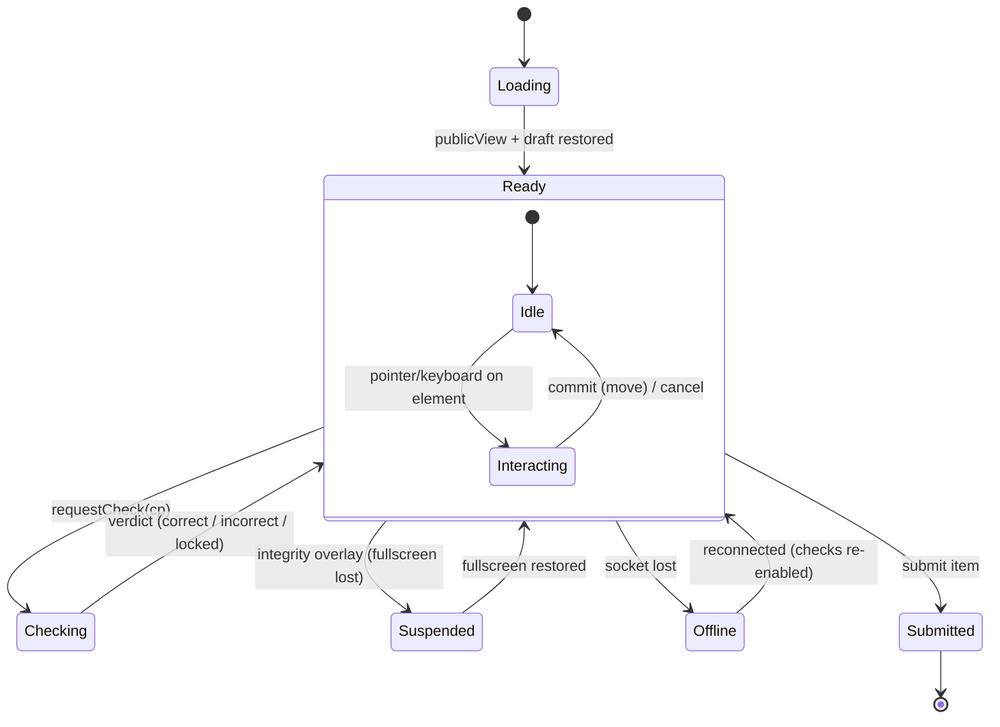
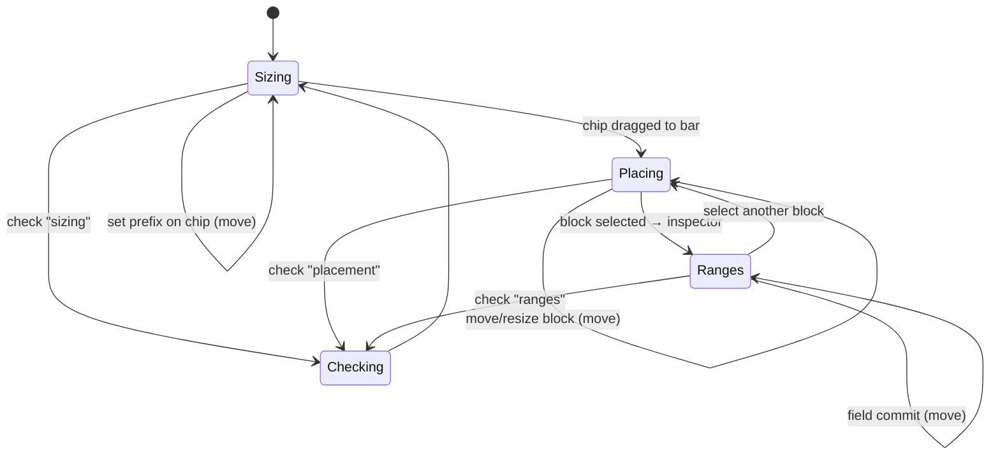
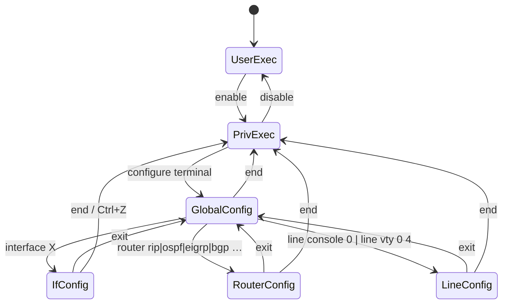

# INTERACTIVE TEMPLATES SPEC — SRM CN Workbench

**Status:** v1.0 · 2026-11-19
**Implements:** PRD §7–8 · ARCHITECTURE §6 (engine contract) · DESIGN_SYSTEM §8 (canvas kit)

This catalogue defines **17 interaction templates**. Each has several modes and covers every theory topic in Units 1–5 and all 15 labs of 21CSC302J. The brief asked for 10–15; there are 17 because Unit 4 alone needs four genuinely different mechanics (timelines, windows, bit arithmetic, frame anatomy). Merging them would make the assessment repetitive, which is the problem this product exists to avoid.

---

## 1. Catalogue overview

| ID | Template | Core mechanic | Primary coverage |
|---|---|---|---|
| T01 | `pinout` — Cable and Media Bench | Drag conductors into RJ-45 pins; layer cross-sections; read a cable tester | Lab 1 · U1 guided media |
| T02 | `patchbay` — Topology Patch Bay | Wire devices port-to-port with the right media; paint domains | Lab 2 · U1 topology, network types · U2 devices |
| T03 | `encap` — Encapsulation Hop Tracer | Stack headers; rewrite fields hop by hop | U1 OSI, TCP/IP, physical layer · U2 devices · U3 forwarding |
| T04 | `delayline` — Link Delay Timeline | Compose latency on a scaled time axis; place frequencies on a spectrum ruler | U1 performance, switching, unguided media |
| T05 | `bitbench` — Address Bit Bench | Toggle bits, drag prefix boundaries, collapse hextets | U2 IPv4, classful, masks, supernetting · U3 IPv6, multicast · U5 MIME Base64 |
| T06 | `slicer` — Address Space Slicer | Partition an address bar into aligned blocks | Lab 4 · U2 FLSM, VLSM, CIDR |
| T07 | `nat` — NAT Translation Tracer | Step packets through a NAT router; maintain the translation table | Lab 6 · U2 NAT |
| T08 | `fib` — Forwarding Investigator | Route packets by longest-prefix match; build and aggregate tables; switch MAC learning | Lab 5 · U3 forwarding, static/default · U2 switch learning |
| T09 | `ios` — IOS Config Console | Type IOS commands to reach a target state; hunt faults in configs | Labs 3, 5–15 |
| T10 | `spf` — Link-State SPF Stepper | Run Dijkstra step by step; derive OSPF costs; paint OSPF areas | U3 link state, OSPF · Labs 9, 10 |
| T11 | `vectors` — Vector Exchange Board | Apply DV/RIP and path-vector/BGP updates; run BGP selection | U3 DV, RIP, PV, BGP · Labs 7, 8, 13 |
| T12 | `medium` — Medium Access Timeline | Classify frames, size vulnerable windows, schedule backoff | U4 ALOHA, CSMA/CD, CSMA/CA, token ring, Ethernet efficiency |
| T13 | `arq` — Sliding Window ARQ Simulator | Drive sender and receiver windows through loss events | U4 flow control, S&W ARQ, GBN, SR |
| T14 | `bitforge` — Bit Forge | XOR long division, Hamming grids, checksum folding | U4 parity, checksum, CRC, Hamming · U5 UDP checksum |
| T15 | `frame` — Frame Assembler | Order frame fields, set control bits, stuff bits, walk PPP phases | U4 Ethernet, HDLC, PPP, token ring · Labs 11, 12 |
| T16 | `hexdump` — Header Hex Dissector | Brush byte ranges onto fields and decode them | U5 ports, UDP, TCP segment |
| T17 | `ladder` — Protocol Sequence Ladder | Place typed messages between lifelines; fill SEQ/ACK and reply codes | U5 TCP, HTTP, FTP, email, DNS, Telnet · U4 HDLC/PPP sessions |

### 1.1 Coverage matrix (every syllabus node maps to ≥ 1 template mode)

| Node | Template:mode(s) |
|---|---|
| `u1.network-types` | `patchbay:scope` |
| `u1.topology` | `patchbay:build`, `patchbay:count` |
| `u1.switching` | `delayline:switching` |
| `u1.osi`, `u1.tcpip` | `encap:stack`, `encap:hops`, `encap:layers` |
| `u1.physical` | `encap:layers`, `delayline:bandwidth` |
| `u1.performance` | `delayline:latency`, `delayline:bdp`, `delayline:bandwidth` |
| `u1.guided` | `pinout:crimp`, `pinout:select`, `pinout:tester`, `pinout:media` |
| `u1.unguided` | `delayline:spectrum` |
| `u2.ipv4`, `u2.address-space` | `bitbench:notation` |
| `u2.classful` | `bitbench:notation`, `bitbench:classful-size` |
| `u2.mask`, `u2.classless` | `bitbench:mask`, `slicer:flsm` |
| `u2.flsm` | `slicer:flsm` |
| `u2.vlsm` | `slicer:vlsm` |
| `u2.nat` | `nat:static`, `nat:dynamic`, `nat:pat` |
| `u2.supernet` | `bitbench:supernet`, `fib:aggregate` |
| `u2.devices` | `patchbay:domains`, `fib:mac-learning`, `encap:hops` |
| `u3.forwarding` | `fib:lpm`, `fib:build`, `fib:aggregate` |
| `u3.static` | `fib:build`, `ios:build` |
| `u3.dv`, `u3.rip` | `vectors:dv-update`, `vectors:rip-update`, `vectors:dv-converge` |
| `u3.ls`, `u3.ospf` | `spf:dijkstra`, `spf:lsdb`, `spf:ospf-cost`, `spf:areas` |
| `u3.pv`, `u3.bgp` | `vectors:pv-update`, `vectors:bgp-select`, `vectors:ibgp-sessions` |
| `u3.eigrp` | `ios:build`, `ios:fault-hunt`, `fib:ad` |
| `u3.multicast` | `bitbench:mcast-mac` |
| `u3.ipv6` | `bitbench:ipv6` |
| `u4.aloha` | `medium:aloha-pure`, `medium:aloha-slotted` |
| `u4.csma-cd` | `medium:csma-cd` |
| `u4.csma-ca` | `medium:csma-ca` |
| `u4.ethernet` | `frame:ethernet`, `medium:ethernet-eff` |
| `u4.token-ring` | `medium:token-ring`, `frame:token-ring` |
| `u4.flow`, `u4.arq` | `arq:stop-wait`, `arq:gbn`, `arq:sr`, `arq:window-size` |
| `u4.parity` | `bitforge:parity` |
| `u4.checksum` | `bitforge:checksum-4bit`, `bitforge:checksum-16` |
| `u4.crc` | `bitforge:crc` |
| `u4.hamming` | `bitforge:hamming` |
| `u4.hdlc` | `frame:hdlc-control`, `frame:bit-stuff`, `ladder:hdlc` |
| `u4.ppp` | `frame:ppp`, `ladder:ppp-chap` |
| `u5.ports` | `hexdump:udp`, `hexdump:tcp` |
| `u5.udp` | `hexdump:udp`, `bitforge:checksum-16` |
| `u5.tcp` | `hexdump:tcp`, `ladder:tcp`, `arq:gbn` (TCP windows) |
| `u5.http` | `ladder:http` |
| `u5.ftp` | `ladder:ftp` |
| `u5.email` | `ladder:smtp`, `bitbench:base64` |
| `u5.telnet` | `ladder:telnet`, `ios:build` (Lab 15) |
| `u5.dns` | `ladder:dns` |
| Lab 1 | `pinout:*` |
| Lab 2 | `patchbay:build` |
| Lab 3 | `ios:build` (basics) |
| Lab 4 | `slicer:vlsm` |
| Lab 5 | `ios:build` (static/default), `fib:build` |
| Lab 6 | `nat:*`, `ios:build` (NAT) |
| Labs 7, 8 | `ios:build` (RIP v1/v2), `ios:fault-hunt`, `vectors:rip-update` |
| Labs 9, 10 | `ios:build` (OSPF single/multi-area), `spf:areas`, `spf:ospf-cost` |
| Labs 11, 12 | `ios:build` (PPP/CHAP, HDLC), `frame:ppp`, `frame:bit-stuff` |
| Lab 13 | `ios:build` (BGP), `vectors:bgp-select` |
| Lab 14 | `ios:build` (EIGRP), `ios:fault-hunt` |
| Lab 15 | `ios:build` (Telnet/VTY), `ladder:telnet` |

## 2. Shared mechanics (all templates)

### 2.1 Workbench shell contract

Every template renderer receives:

```ts
interface TemplateProps<Pub, Draft> {
  publicView: Pub;                 // from server; never contains solutions
  draft: Draft;                    // restored snapshot (resume after reconnect)
  checkpoints: CheckpointDef[];    // ids, titles, weights, fields
  policy: { feedback: "binary" | "checkpoint" | "none"; tools: ToolId[] };
  emit: (e: TelemetryEvent) => void;          // moves, undo, reset, …
  requestCheck: (checkpointId: string, response: unknown) => Promise<Verdict>;
  onDraftChange: (d: Draft) => void;          // debounced snapshot
}
```

Each renderer is backed by an **XState v5 machine** that owns all canvas state. Machine events correspond 1:1 to telemetry events, so any attempt can be **replayed** for teacher review by feeding the logged events back into the machine.

### 2.2 Moves, undo, reset

- **Move** = a committed state mutation: a drop, toggle, connect/disconnect, field commit (blur or Enter), a CLI line entered, or a selection that changes the answer state. Hovering, panning, zooming, opening help, and focusing elements are not moves.
- **Undo/redo** (⌘Z / ⇧⌘Z) are logged separately (`undo`, `redo`) and are **not** counted as moves. They count toward oscillation detection (R3) only when the same element flips state ≥ 3 full cycles.
- **Reset item** clears the canvas. It is logged as `reset` (moves are not reset; the counter is cumulative) and needs a confirm.
- **Optimal moves (m̂)** are computed **per instance** by the template's solver, so every student's benchmark is exact for their own values.

### 2.3 Checkpoints and checks

- An instance has 1–6 checkpoints, each with a weight and a list of fields. Students can check any checkpoint whose fields are complete. Checkpoints are not forced into a strict order unless the blueprint sets `sequential: true` (used where a later step depends on an earlier one, e.g. CRC division before the codeword).
- `maxChecksPerCheckpoint` defaults to 4. When the limit is reached, the checkpoint **locks** with its last graded score.
- Multi-field checkpoints award fractional credit (e.g. 4 of 5 host-range fields correct → 0.8).
- **Sequential checkpoints and dependent values:** when a later checkpoint depends on an earlier wrong value, the grader can apply **error carried forward (ECF)** if the blueprint enables it. The later step is graded against the student's own earlier value and receives 0.75 of full credit when it is consistent with that value. Misconception tags still record the original error.

### 2.4 Trial-and-error defaults (PRD §8.3)

| Rule | Easy | Medium | Hard |
|---|---|---|---|
| R1 τ_checks (wrong checks before flag) | 2 | 3 | 4 |
| ŵ (free wrong checks in f_w) | 1 | 1 | 2 |
| R2 ρ (move inflation) | 2.0 | 2.5 | 2.5 |
| R3 oscillation cycles / window | 3 / 30 s | 3 / 30 s | 3 / 45 s |
| R4 check spam | ≥ 3 checks in 15 s with ≤ 1 move between | same | same |
| R5 enumeration sweep | ≥ 4 consecutive (1 change → check) pairs | same | same |

Each template below lists what counts as an "element" for R3 and any rule overrides.

### 2.5 Tools

A blueprint declares which in-app tools are available. Tool usage is logged as telemetry but never penalised, since fullscreen removes access to external tools.

| Tool | Contents | Forbidden in |
|---|---|---|
| `calc-basic` | + − × ÷, parentheses, powers, eˣ, log₂, scientific notation | — |
| `calc-programmer` | binary/decimal/hex conversion | `bitbench`, `hexdump`, `bitforge` (it would trivialise them) |
| `port-registry` | Searchable list of service names (no numbers) | — |
| `scratchpad` | Plain-text notes, per item, not graded | — |

### 2.6 Keyboard model (all drag interactions)

`Tab` / arrow keys move focus between sources and targets. `Enter` picks up or drops. `Esc` cancels. `Space` toggles bits or cells. `⌘Enter` checks the focused checkpoint. `[` and `]` move to the previous or next item. Each template's **Keyboard** row adds anything specific.

### 2.7 Anti-outsourcing properties (why phones, Lens, and LLMs don't help much)

1. **Per-student values.** A photographed problem only helps the student who owns it, and their own answer still has to be entered on the canvas.
2. **The answer is a construction, not a choice.** An LLM can describe VLSM, but the student must still drag 5 aligned blocks and type 15 addresses within the time budget.
3. **Process telemetry.** Long idle time followed by a burst of correct moves with no exploration is visible in replay. In v1 this is visible, not scored; Phase 3 research may turn it into a signal.
4. **The integrity overlay hides content** when fullscreen is lost, so photographing a laptop requires staying in fullscreen and holding a phone up in a supervised classroom.
5. **Watermark** (register number) on every canvas.

### 2.8 Visual state-machine skeleton

Every template's machine follows this outer shape. Per-template inner states are listed in §3.



---

## 3. Template specifications

Each specification lists the following. Times are defaults; blueprints can override them, and pilot calibration (ARCHITECTURE §6.5) tunes them.
- Coverage
- Modes
- Interaction
- Inner state machine
- Parameters and constraints
- Difficulty knobs
- Checkpoints
- Expected time and optimal moves
- T&E specifics
- Misconception tags
- Keyboard path

---

### T01 · `pinout` — Cable and Media Bench

**Covers:** Lab 1 (Packet Tracer cables, colour codes, peer-to-peer), `u1.guided`.
**Convention:** Packet Tracer cabling rules (no Auto-MDIX assumed): unlike devices (PC↔switch, switch↔router, PC↔hub) use **straight-through**; like devices (PC↔PC, switch↔switch, router↔router, hub↔switch, and PC↔router, since both are MDI) use **crossover**; console uses **rollover**.

**Modes**
- `crimp`: build one connector end to a named standard (T568A or T568B).
- `select`: two devices are shown with one end already crimped. Choose the cable type for the link, then crimp end B consistently.
- `tester`: a continuity tester shows the remote unit's LED order (e.g. `1 2 6 4 5 3 7 8`). Classify the cable (straight, crossover, rollover, or faulty: split pair, reversed pair, open) and re-crimp end B to fix it.
- `media`: cross-section assembly. Drag layers into a coax cut (inner conductor → insulator → outer conductor → plastic cover) or a fiber cut (core → cladding → buffer → Kevlar → jacket). Then choose a medium and connector (RJ-45, BNC, ST, SC, MT-RJ) for a parameterised scenario (distance, EMI, bandwidth, cost).

**Interaction:** an 8-slot RJ-45 connector (clip down, pins 1–8 left to right, labelled) and a tray of 8 conductors in a seeded shuffled order. Drag a conductor onto a pin. Dropping onto an occupied pin swaps the two. In `select`, drag a cable spool onto the link between the devices.

**Inner states:** `TrayFull → Placing(n/8) → Complete → (Checking)`. `select` adds `ChoosingCable → Crimping`; `tester` adds `ReadingTester → Classifying → Fixing`.

**Parameters:** device pair from a 9-pair set; end-A standard {568A, 568B}; tray permutation (cosmetic); tester fault {none, split pair 3↔6 with 4↔5, reversed, two-wire swap at pins (i, j)}; media scenario (distance 10 m–40 km, EMI level, required rate).

**Difficulty:** E = `crimp` with a named standard · M = `select` (cable choice + end B) or `media` · H = `tester` with a compound fault, then fix.

**Checkpoints:**
- `crimp`: pin order (8 fields, weight 1).
- `select`: cable type (0.3) and end-B order (0.7).
- `tester`: classification (0.4) and fixed order (0.6).
- `media`: layer order (0.5) and medium/connector choice (0.5).

**Expected time / m̂:**

| Difficulty | Expected time | m̂ |
|---|---|---|
| Easy | 75 s | 8 (one drag per conductor) |
| Medium | 120 s | 1 + 8 |
| Hard | 180 s | 1 + number of misplaced conductors (a swap counts as 1) |

**T&E element:** a pin. R3 fires on repeated swaps of the same pin pair.

**Entropy note:** the correct order for a given standard is universal knowledge, so neighbour-copying can't be prevented for `crimp`. Use it for **Easy only**. The space must include the device pair and tester fault (CI flag `lowEntropyCore: true` lets the blueprint through with a recall-only label).

**Misconceptions:** `pinout.568a-568b-pairs-swapped`, `pinout.stripe-solid-swapped`, `cable.straight-for-like-devices`, `cable.crossover-for-unlike-devices`, `cable.rollover-misuse`, `tester.split-pair-missed`, `media.layer-order`.

**Keyboard:** Tab across tray conductors → Enter → arrows to a pin → Enter.

---

### T02 · `patchbay` — Topology Patch Bay

**Covers:** Lab 2, `u1.topology`, `u1.network-types`, `u2.devices`.

**Modes**
- `build`: wire a required topology (bus with taps, star, ring, full mesh, hybrid) using the correct media between correct port types: copper straight/cross, serial DCE/DTE with the clock side marked.
- `count`: mesh arithmetic grounded in a partially built mesh. "This full mesh will have n devices. Add the missing links. How many links and I/O ports per device in total?" The answers are n(n−1)/2 and n−1.
- `domains`: a seeded topology of hubs, switches, bridges, and routers. Paint **collision domains** with a brush, then switch to the broadcast brush and paint **broadcast domains**.
- `scope`: a map with sites at parameterised distances and ownership (desk, building, campus 2 km, city 30 km, other country). Draw boundaries and label each one PAN/LAN/MAN/WAN (point-to-point or switched).

**Interaction:** xyflow canvas. Drag devices from the palette (`build`) or start from a seeded layout. To connect, drag from a port to a port. The cable type is chosen in a popover at drop time and is part of the answer. Domain brushes assign each segment (link or shared medium) to a domain colour (`--cat-*` plus a pattern).

**Inner states:** `Placing → Connecting(port A selected) → ChoosingMedia → Connected`; `domains`: `BrushCollision ⇄ BrushBroadcast`.

**Graded as graph predicates, not pixel layout:**
- ring = connected, every vertex degree 2, |E| = |V|;
- star = one centre of degree k, leaves of degree 1;
- mesh = complete graph;
- bus = a backbone path with tap nodes of degree 1 on it;
- hybrid = each sub-spec satisfied, plus the declared joining edges.

**Parameters:** n (4–7), device mix, port inventories (so mesh port limits matter), DCE side, domain topologies (1–3 routers, 1–3 switches, 0–2 hubs, 0–1 bridge, 3–12 hosts), site distances.

**Difficulty:**
- Easy: star/ring/bus with ≤ 5 devices, or `count` with n ≤ 5, or `scope`.
- Medium: full mesh n = 5–6 with serial DCE choice, or `domains` with ≤ 4 devices.
- Hard: hybrid spec, or `domains` with a bridge, hub, and switch behind two routers.

**Checkpoints:**
- `build`: shape (0.5), media per edge (0.3), counts (0.2).
- `domains`: collision partition (0.5), broadcast partition (0.5); partitions are compared set-wise.

**Expected time / m̂:** E 120 s · M 240 s · H 360 s. m̂ = required links (each connection with its media choice is one move) + counts entered; for `domains`, m̂ = segments to assign.

**T&E element:** a port pair (connect/disconnect cycles) or a segment's domain assignment.

**Misconceptions:** `mesh.links-n-squared`, `mesh.ports-n`, `domains.hub-splits-collision`, `domains.switch-splits-broadcast`, `domains.bridge-not-splitting`, `domains.router-not-splitting-broadcast`, `cable.serial-dce-missing`, `scope.man-wan-confused`.

**Keyboard:** Tab to a device → Enter → arrows cycle ports → Enter, then Tab to the target device and port → Enter → arrows pick the media → Enter.

---

### T03 · `encap` — Encapsulation Hop Tracer

**Covers:** `u1.osi`, `u1.tcpip`, `u1.physical`, `u2.devices`, `u3.forwarding` (L2 rewrite per hop).

**Modes**
- `stack`: build the encapsulation for a message. Drag header blocks into order: application data → TCP/UDP header (ports) → IP header (addresses) → frame header (MACs) + trailer. Fill each header's key values from an address palette that holds this scenario's MACs, IPs, and ports **plus distractors** (e.g. the next router's MAC).
- `hops`: animate the packet along a path (Host A — SW — R1 — R2 — SW — Host B). At each link, set src/dst MAC, src/dst IP, and TTL. At each device, select which layers it processed (switch L1–L2, router L1–L3).
- `layers`: scenario cards bound to *this* instance's events, e.g. "R1 decremented TTL from 64 to 63" or "the NIC on Host B checked FCS". Place each on the correct OSI layer, then on the correct TCP/IP layer (Forouzan's 5-layer suite).

**Inner states:** `Stacking → FillingHeaders → (hops) AtLink(i) → AtDevice(i) → … → Delivered`.

**Parameters:**
- hop count 1–4;
- MAC and IP addresses (random; private or public);
- application {HTTP 80/TCP, DNS 53/UDP, FTP 21/TCP, SMTP 25/TCP, Telnet 23/TCP};
- initial TTL {64, 128, 255};
- optional NAT at R1 (Hard), which rewrites the source IP.

**Difficulty:** E = `stack` with 1 router · M = `hops` with 2 routers · H = `hops` with 3 routers + NAT + TTL + `layers`.

**Checkpoints:** stack order (0.25), origin header values (0.25), per-hop rewrites (0.4, fractional per field), device layers (0.1).

**Expected time / m̂:** E 120 s · M 240 s · H 360 s. m̂ = header blocks + fields set at the origin + 4 fields × links + 1 × devices.

**T&E element:** a header block's position, or one field at one hop.

**Misconceptions:** `encap.wrong-order`, `encap.mac-end-to-end`, `encap.ip-changes-per-hop`, `encap.switch-rewrites-mac`, `encap.ttl-not-decremented`, `encap.router-l2-only`, `ports.wrong-transport`.

**Keyboard:** standard pick and drop. Fields are mono inputs fed from the palette (Enter on a palette value fills the focused field).

---

### T04 · `delayline` — Link Delay Timeline

**Covers:** `u1.performance`, `u1.switching`, `u1.unguided`, `u1.physical`.

**Modes**
- `latency`: a scaled time axis from "first bit leaves" to "last bit arrives". Drag four segment handles (transmission, propagation, queuing, processing) to their lengths, enter each value with units, then click the dominant component.
- `bdp`: a pipe with a bit-fill handle. Fill the link with bandwidth × propagation delay bits and enter the value.
- `bandwidth`: a frequency band slider for Hz bandwidth (highest − lowest), plus the bps scaling from the slide examples (4 kHz → 56 kbps ⇒ 8 kHz → 112 kbps).
- `switching`: two lanes. Circuit-switched: setup + transfer + teardown. Packet-switched: store-and-forward across k links. Size the segments and compare totals.
- `spectrum`: a log ruler from 3 kHz to 900 THz. Place the given frequencies, then assign each one a band (VLF … EHF), a propagation method (ground below 2 MHz, sky 2–30 MHz, line-of-sight above 30 MHz), and a media class (radio, microwave, infrared).

**Interaction:** the axis toggles between linear and log (so 50 ms against 0.02 ms is visible). Segment edges snap to 1 µs. Values are typed in mono inputs with a unit selector.

**Inner states:** `Placing(segment k) → Entering → (all placed) → ChoosingDominant`.

**Parameters:** all integers in base units, chosen so every answer is exact:
- distance 1–20,000 km;
- propagation speed 2×10⁸ or 2.4×10⁸ m/s (cable, per the slides) or 3×10⁸ (vacuum);
- message size bytes/KB/MB, using **1 KB = 1,000 bytes as in the slides**;
- bandwidth 1 kbps–10 Gbps;
- queuing and processing given.

**Difficulty:**
- Easy: propagation + transmission, one unit conversion.
- Medium: all four delays, mixed units, dominant component.
- Hard: two-hop store-and-forward over links with different bandwidths (total = Σ per-link transmission + Σ propagation + queuing), plus BDP, or the `switching` comparison.

**Checkpoints:** each component value (equal weights, tolerance 0 because answers are exact), total, dominant (0.1).

**Expected time / m̂:** E 90 s · M 180 s · H 300 s. m̂ = segments placed + values entered + 1.

**Tools:** `calc-basic`.

**Misconceptions:** `delay.bytes-not-bits`, `delay.kb-1024`, `delay.ms-us-confusion`, `delay.store-forward-counted-once`, `delay.prop-uses-bandwidth`, `band.ground-sky-boundary`.

---

### T05 · `bitbench` — Address Bit Bench

**Covers:** `u2.ipv4`, `u2.address-space`, `u2.classful`, `u2.mask`, `u2.classless`, `u2.supernet`, `u3.ipv6`, `u3.multicast`, `u5.email` (Base64).

**Modes**
- `mask`: a 32-cell BitField shows the address. Drag the **prefix boundary handle** to /n. A result row starts as a copy of the address. Toggle host bits to produce the **network address** (clear host bits = AND), then on a second row the **broadcast address** (set host bits = OR NOT mask). Dotted decimal renders live under each row. Finally enter the number of addresses (2³²⁻ⁿ) and usable hosts.
- `notation`: convert dotted ↔ binary ↔ hex by toggling bits and typing octets. Identify the class from the leading-bit pattern by dragging a class marker onto the leading bits (`0`, `10`, `110`, `1110`, `1111`).
- `classful-size`: given device counts per site (slide p.51 style), drag the network/host boundary to the class position, then enter total, usable, needed, and unused addresses.
- `supernet`: 2ᵏ candidate blocks are stacked as binary rows. Exclude non-contiguous or misaligned decoys, then drag the shared prefix boundary left to the longest common prefix and read off the summary.
- `ipv6`:
  - (a) collapse: drag leading zeros out of hextets and merge one zero run into `::`;
  - (b) classify by highlighting the prefix bits that decide the block (2000::/3, FE80::/10, FC00::/7, FF00::/8);
  - (c) EUI-64: split the MAC, insert the `FF:FE` tile, flip the U/L bit (the 7th bit of byte 0) in a BitField, and prepend `fe80::`.
- `mcast-mac`: copy the low 23 bits of an IPv4 multicast address into the `01:00:5E` + `0` template BitField.
- `base64`: three bytes as a 24-bit field. Drag 6-bit dividers, then map each 6-bit value to its character (slide Table 26.10 is available as a reference panel).

**Inner states:** `BoundarySet? → EditingRow(network) → EditingRow(broadcast) → EnteringCounts`.

**Parameters:**
- address and prefix drawn under constraints (no 0.x, 127.x, or 255.x unless the item is about special addresses);
- class distribution per blueprint;
- supernet block count 4 or 8, decoy type;
- IPv6 hextets with engineered zero runs (ties between runs for Hard; display follows RFC 5952 leftmost-longest, and the grader accepts any valid single `::` form);
- MAC with a chosen U/L bit;
- multicast group with the 5 ambiguous high bits set (to test the 23-bit loss);
- Base64 bytes.

**Difficulty:**
- Easy: prefix in the last octet (/24–/30), `notation`, or `ipv6` collapse.
- Medium: boundary in octet 2 or 3 (/12–/23), `supernet` of 4, or EUI-64.
- Hard: `supernet` of 8 with an aligned trap; IPv6 collapse + classify + EUI-64 chained; or `mcast-mac` + the reverse "which groups share this MAC" (32 groups).

**Checkpoints (`mask`):** prefix/mask (0.2), network (0.3), broadcast (0.3), counts (0.2).

**Expected time / m̂:** E 75 s · M 150 s · H 240 s. In `mask`, m̂ = 1 (boundary) + (32 − n) host-bit toggles (popcount for the network row + zero count for the broadcast row) + 2 count fields.

**Tools:** `calc-basic` (never `calc-programmer`).

**T&E element:** a single bit cell. R3 is tuned to ≥ 4 flips of the same cell, since single flips back are common.

**Misconceptions:** `mask.and-vs-or`, `mask.boundary-off-by-one`, `subnet.usable-off-by-two`, `class.leading-bits`, `class.range-boundary`, `supernet.non-contiguous`, `supernet.unaligned`, `ipv6.double-colon-twice`, `ipv6.trailing-zeros-dropped`, `eui64.no-ul-flip`, `eui64.fffe-position`, `mcast.24-bits-copied`, `base64.8-bit-groups`.

---

### T06 · `slicer` — Address Space Slicer

**Covers:** Lab 4, `u2.flsm`, `u2.vlsm`, `u2.classless` (power-of-two blocks; first address divisible by block size).

**Modes**
- `flsm`: set borrowed bits k (2ᵏ ≥ subnets). The bar splits into 2ᵏ equal blocks. Fill network, broadcast, first host, and last host for the subnets the blueprint names (e.g. "first and last", as in slides p.83–94).
- `vlsm`: requirement chips (e.g. "LAN B · 28 hosts") arrive in a **seeded unsorted order**. For each chip:
  - set its prefix with a stepper (`/27`) — the **sizing** step;
  - drag it onto the address bar — the **placement** step; blocks snap to a 4-address grid, **not** to their alignment, so alignment is tested;
  - in the inspector, enter first host, last host, broadcast, and dotted mask — the **ranges** step; the network address shows from placement.

**Placement policy (per blueprint):**
- `canonical` (default; it matches the taught procedure: largest first, sequential lowest block). Full credit only for the canonical layout. Any other valid non-overlapping aligned layout earns 0.5 of the placement weight with tag `vlsm.non-canonical-order`.
- `any-valid`: any non-overlapping aligned layout earns full credit.



**Parameters:**
- parent block: /16–/24 (Medium) or /20–/22 crossing an octet boundary (Hard, e.g. slide p.105: 172.22.0.0/20); private or public-looking;
- k requirements (3–8) with host counts drawn so each prefix is unambiguous (never exactly 2ʰ − 2 + 1 unless the blueprint targets that edge);
- WAN /30 count 0–3;
- input order shuffled.

**Fingerprint:** {k, multiset of prefixes, WAN count, crossesOctet, totalUtilisation band}.

**Difficulty:**
- Easy: `flsm` with 4 subnets in a /24, fill 2 subnets.
- Medium: `vlsm` with 4–5 requirements (incl. 1 WAN) in a /24.
- Hard: `vlsm` with 6–8 requirements (incl. 2–3 WANs) in a /20–/22, plus "summarise the remaining free space as the fewest CIDR blocks".

**Checkpoints:** sizing (0.3), placement (0.3), ranges (0.4, fractional per field). ECF applies to ranges.

**Expected time / m̂:** E 180 s · M 300 s · H 540 s. m̂ = k (sizing) + k (placements) + 4k (first, last, broadcast, mask), e.g. 30 moves for 5 requirements.

**T&E element:** a block's position, or one chip's prefix.

**Misconceptions:** `vlsm.not-sorted-desc`, `vlsm.overlap`, `vlsm.unaligned`, `subnet.usable-off-by-two`, `subnet.broadcast-off-by-one`, `flsm.borrowed-bits`, `mask.wrong-dotted`, `cidr.block-not-power-of-two`.

**Keyboard:** Tab to a chip → `+`/`−` adjust the prefix → Enter picks up → ←/→ move by block size (Shift = 4-address step) → Enter drops.

---

### T07 · `nat` — NAT Translation Tracer

**Covers:** Lab 6, `u2.nat`. Uses Forouzan's translation-table vocabulary (private/external address and port, protocol) and also shows the Cisco terms (inside local, inside global) in the column header tooltip.

**Modes**
- `static`: 1:1 mappings are preconfigured. Rewrite headers for outbound and return traffic, and decide whether an inbound packet to an unmapped public address is dropped.
- `dynamic`: a pool of public addresses (chips). Assign a free pool address to each new inside host; when the pool is exhausted, choose **drop**; release mappings when sessions end (event-driven).
- `pat`: one public address (overload). Fill five-column rows (private IP, private port, external/public port, destination, protocol), resolve a source-port conflict by assigning a unique public port, and reverse-translate replies.

**Interaction:** the topology runs inside hosts → NAT router (inside/outside interfaces marked) → servers. A packet queue is advanced with **Step ▸**. At the router the simulation pauses on a translation decision: fill or select the table row, then drag values into the packet's src/dst fields. Return packets need a table lookup (the row is clicked to select it; the click is a move).

**Inner states:** `Queue → AtRouter(outbound|inbound) → EditingTable → RewritingHeader → Forwarded | Dropped → Queue`.

**Parameters:** inside subnet, 2–5 hosts, client ports (ephemeral, with deliberate collisions in Hard), public address or pool (2–3 addresses), servers and ports, event order (including a session end that frees a pool address, and an unsolicited inbound packet).

**Difficulty:** E = static, 2 flows · M = dynamic pool with exhaustion and release · H = PAT with 4–5 flows, a port conflict, returns, and an unsolicited packet.

**Checkpoints:** one per packet event (table row + header rewrite, fractional per field), plus drop decisions.

**Grading of PAT ports:** the original source port must be preserved when it is free. On a conflict, any unused public port is accepted (Cisco IOS behaviour varies by version and PT build).

**Expected time / m̂:** E 120 s · M 240 s · H 360 s. m̂ = Σ (row fields + rewritten fields + lookups) over events.

**Misconceptions:** `nat.rewrite-dst-outbound`, `nat.rewrite-src-inbound`, `nat.pool-reuse-active`, `nat.pool-not-released`, `pat.port-collision`, `nat.unsolicited-accepted`, `nat.inside-outside-swapped`.

---

### T08 · `fib` — Forwarding Investigator

**Covers:** Lab 5, `u3.forwarding`, `u3.static`, `u2.devices` (switch learning), `u3.eigrp` / AD (lab convention).

**Modes**
- `lpm`: a router with a forwarding table (mask, network, next hop, interface) and a queue of packets with destination IPs. Drag each packet onto the outgoing interface port, or into the **Drop** bin when no match exists and there is no default route. A "binary lens" (hold Alt) overlays destination bits against each prefix. The lens shows bits only, never a verdict.
- `build`: given a topology (Forouzan Example 18.7 style), construct R1's table: drag network chips from the diagram into rows, click the interface on the diagram, click the next-hop interface IP for remote networks, and sort rows by mask length (drag handle).
- `aggregate`: collapse rows into an aggregate entry and keep a more-specific exception where needed (Fig. 18.34–18.35); prove it by forwarding three test packets.
- `ad` (cisco-ios convention): candidate routes from connected (0), static (1), EIGRP (90), OSPF (110), and RIP (120) for overlapping prefixes. Choose what `show ip route` installs (lowest AD for an identical prefix; longest prefix across different ones), then forward packets.
- `mac-learning`: a switch with 4–6 ports and a frame sequence. For each frame, update the switching table (learn the source MAC → port) and choose forward / flood / filter for the destination.

**Inner states:** `Queue → PacketSelected → Dropped/Forwarded`; `build`: `AddingRow → FillingRow → Sorting`.

**Parameters:** 4–8 rows with nested prefixes (at least one non-octet boundary for Medium and Hard), default route presence, packets engineered to hit each row once, ≥ 1 multi-match case, and a no-match case.

**Difficulty:** E = `lpm` with 4 rows, octet-aligned prefixes, 3 packets · M = `lpm` with nested non-octet prefixes, 5 packets, or `mac-learning` · H = `build` + `aggregate` + 3 packets, or `ad`.

**Checkpoints:** per packet (equal weights); `build`: rows (fractional per field) and order.

**Expected time / m̂:** E 90 s · M 180 s · H 420 s. m̂ = packets (+ rows × 3 fields + sort moves).

**Misconceptions:** `lpm.first-match`, `lpm.shortest-match`, `lpm.default-preferred`, `fib.next-hop-for-connected`, `fib.unsorted`, `ad.metric-across-protocols`, `switch.learn-destination`, `switch.flood-known`.

---

### T09 · `ios` — IOS Config Console

**Covers:** Labs 3, 5, 6, 7, 8, 9, 10, 11, 12, 13, 14, 15 (convention `cisco-ios`; IOS 15.x on Packet Tracer 1941/2911 routers and 2960 switches. Exact device models will be confirmed against the department's lab records; see PRD A1).

**Modes**
- `build`: reach a target configuration state described as **objectives, not commands**. For example: "Gi0/0 uses the first usable address of 10.14.32.64/27" or "Only area-1 interfaces participate in OSPF area 1".
- `fault-hunt`: given `show running-config` (and optionally `show ip interface brief`) for 1–2 routers plus a symptom ("R1 and R2 do not form an EIGRP adjacency"), click the faulty lines to mark them, then type the corrective commands.

**Interaction:** three panes.
- **Topology:** an SVG diagram with interface names and per-student addressing objectives.
- **Terminal:** a custom renderer, mono, with real IOS prompts: `R1>`, `R1#`, `R1(config)#`, `R1(config-if)#`, `R1(config-router)#`, `R1(config-line)#`. It supports abbreviations (`conf t`, `int g0/0`, `no shut`), `?` help in the current mode, Tab completion (blueprint may disable it for Hard), `do`, `exit`, `end`, ↑ history, and `show running-config` / `show ip interface brief` / `show ip protocols` / `show ip route` (connected + static + configured protocol networks; dynamic adjacency outcomes are not simulated in v1).
- **Objectives:** a checklist of objectives. Their completion is not revealed live; only checks verify.

Paste is disabled. Each **entered line** is one move. `?` and `show` commands are not moves.

**Grading — semantic, not textual:**
1. Lines are parsed by `@cn/netkit/ios`, a subset grammar of about 140 IOS 15 commands, into a **config state**: hostname, enable secret/password, line console/vty (password, login, transport input), interfaces (ip/mask, shutdown, clock rate, encapsulation hdlc/ppp, ppp authentication, ip nat inside/outside), static routes, `router rip` (version, networks normalised classful, auto-summary, passive), `router ospf` (pid, router-id, network/wildcard/area), `router eigrp` (AS, networks/wildcards, auto-summary), `router bgp` (AS, neighbors/remote-as, network/mask), NAT (static, pool, list, overload), access-lists, and usernames.
2. Objectives are **predicates over the resulting state**, e.g. `ospfArea(R1, "Gi0/1") === 1`. Any `network` + wildcard that enables exactly the intended interfaces passes (`network 10.5.12.1 0.0.0.0 area 1` and `network 10.5.12.0 0.0.3.255 area 1` are both correct for 10.5.12.1/22).
3. Over-configuration that breaks an objective's intent fails that objective (e.g. advertising an inside network into BGP when told not to).



**Parameters:**
- hostnames;
- passwords (pronounceable, 8 chars, seeded);
- router model → interface names;
- addressing objectives expressed indirectly (first/last usable, from VLSM plans);
- DCE side;
- RIP version and networks (incl. a discontiguous network for v1 vs v2);
- OSPF pid (1–65535), areas (0 + 1–2 others), router-ids;
- EIGRP AS (1–65535);
- BGP private AS (64512–65534), neighbor IPs, advertised prefixes;
- NAT pool and ACL;
- CHAP usernames (= the peer's hostname);
- faults for `fault-hunt` from a fault library (below).

**Fault library (`fault-hunt`):** missing `no shutdown`; clock rate on the DTE side; subnet-mask typo; RIP version mismatch; `auto-summary` left on with a discontiguous network; OSPF area mismatch on a link; OSPF wildcard written as a mask; EIGRP AS mismatch; EIGRP network statement not covering the interface; BGP `remote-as` wrong; BGP `network` mask not matching the RIB; static route next hop not on a connected subnet; NAT inside/outside swapped; NAT ACL wildcard wrong; PPP on one side and HDLC on the other; CHAP username not equal to the peer hostname or password mismatch; VTY `login` missing; `transport input` missing.

**Difficulty:**
- Easy: Lab 3 basics, ≤ 6 objectives, direct values.
- Medium: one routing protocol or NAT with computed values (wildcards, first-usable).
- Hard: multi-area OSPF + PPP/CHAP, or BGP + EIGRP redistribution boundaries, or `fault-hunt` with 2–3 faults across 2 routers.

**Checkpoints:** one per objective group (e.g. "Security", "Interfaces", "Routing"), fractional per objective.

**Expected time / m̂:** E 240 s · M 420 s · H 600 s. m̂ = the solver's **minimal canonical line count**: mode transitions plus commands, with abbreviations allowed. Typing speed is not measured; lines are.

**T&E elements:** a `(mode, command-key)` pair. R3 fires on `shutdown`/`no shutdown` flapping, or on re-issuing `network` variants ≥ 3 times. R5 fires when a check follows each single-line change ≥ 4 times.

**Misconceptions:** `ios.missing-no-shutdown`, `ios.clock-rate-on-dte`, `ios.enable-password-not-secret`, `ios.vty-no-login`, `ios.wrong-mode`, `rip.v2-auto-summary-on`, `rip.network-missing`, `ospf.wildcard-is-mask`, `ospf.area-mismatch`, `eigrp.as-mismatch`, `eigrp.network-not-covering`, `bgp.remote-as-wrong`, `bgp.network-mask-mismatch`, `static.next-hop-unreachable`, `default.wrong-format`, `ppp.chap-username-not-peer`, `ppp.encap-mismatch`, `hdlc.encap-mismatch`, `nat.inside-outside-swapped`, `nat.acl-wildcard`, `telnet.no-transport-input`, `telnet.no-enable-secret`.

**Keyboard:** native terminal. `Esc` returns focus to the objectives list.

---

### T10 · `spf` — Link-State SPF Stepper

**Covers:** `u3.ls`, `u3.ospf`, Labs 9 and 10, `u2.devices` (STP root and shortest paths, as an optional blueprint).

**Modes**
- `lsdb`: LSPs arrive from each node (node, neighbour, cost). Fill the LSDB matrix (∞ where there is no link). Symmetry is graded.
- `dijkstra`: a weighted graph with a root, plus a tentative-distance table with one row per iteration (Forouzan Table 20.2). Each iteration:
  1. click the **closest node not yet in the tree** to finalise it (its tree edge from the predecessor becomes solid);
  2. enter **updated tentative distances** for its non-tree neighbours.

  At the end, fill the root's forwarding table (destination, next hop, cost).
- `ospf-cost` (cisco-ios): links are labelled with bandwidths. Compute interface costs as 10⁸ / bandwidth (reference 100 Mbps, minimum 1), then run `dijkstra` on those costs.
- `areas`: an AS with routers and links. Paint areas, label each router Internal / ABR / Backbone / ASBR (Forouzan Fig. 20.21), and fix the one area that does not touch area 0.

**Inner states:** `Iteration(i): PickingNode → UpdatingNeighbours → (next)`; after the last pick → `BuildingFIB`.

**Parameters:** |V| 5–8, |E| from |V|+1 to 2|V|, weights 1–15. Constraints: a unique shortest-path tree, no equal-distance ties at pick time, and an exact number of improvements (tentative distance decreases) per difficulty. `ospf-cost` uses bandwidths from {10 Mbps, 100 Mbps, 1 Gbps, 1.544 Mbps T1, 64 kbps} with Cisco integer truncation.

**Fingerprint:** {|V|, |E|, improvements, max SPT depth}.

**Difficulty:**
- Easy: |V| = 5, 1 improvement; tentative values pre-filled, so the student picks order and final distances.
- Medium: |V| = 6, 3–4 improvements, enter tentative values, forwarding table.
- Hard: |V| = 7–8 with `ospf-cost`, or `areas` + ABR identification.

**Checkpoints:** pick order (0.3), distances (0.3), predecessors/SPT (0.2), forwarding table next hops (0.2).

**Expected time / m̂:** E 150 s · M 300 s · H 480 s. m̂ = (|V| − 1) picks + Σ tentative updates + forwarding table entries.

**Misconceptions:** `dijkstra.picked-non-min`, `dijkstra.no-relaxation`, `dijkstra.relaxed-finalised`, `dijkstra.next-hop-is-predecessor`, `lsdb.asymmetric`, `ospf.cost-inverted`, `ospf.abr-misidentified`, `ospf.area-not-adjacent-backbone`.

**Keyboard:** arrows move between graph nodes in a deterministic order (alphabetical); Enter finalises; Tab moves into the iteration table.

---

### T11 · `vectors` — Vector Exchange Board

**Covers:** `u3.dv`, `u3.rip`, `u3.pv`, `u3.bgp`, Labs 7, 8, 13.

**Modes**
- `dv-update`: node X's vector and a vector received from neighbour W at link cost c. Apply `D[y] = min(D[y], c + D_W[y])` row by row.
- `rip-update` (forouzan): Forouzan's three rules. Add one hop and set the next router to the sender. Then **add** a route that is unknown, **replace** one that is cheaper, **replace** one from the same next router even if it costs more, and otherwise **keep**. A directly connected network costs 1 hop. 16 = ∞.
- `dv-converge`: tables for 4–5 routers. Compute the tables after round k. Hard adds a link failure that shows count-to-infinity, with the question "after how many exchanges does the cost reach 16?"
- `pv-update`: receive a neighbour's path vector, prepend yourself, discard paths that contain yourself (loop prevention), and choose the best under the stated policy (minimum hops, or avoid AS X).
- `bgp-select` (forouzan Fig. 20.30): 3–5 candidate routes with LOCAL-PREF, MED, AS-PATH, NEXT-HOP cost, origin (external or internal), and BGP identifier. Walk the flowchart. At each diamond, select the surviving candidates; it stops when one remains.
- `ibgp-sessions`: AS diagrams with n routers. Draw the iBGP full mesh, n(n−1)/2 sessions, and mark eBGP pairs.

**Interaction:** router cards with tables (Dest | Next | Cost, or Dest | Path). The incoming vector animates along the link. For each row, choose an action chip (**Add / Replace / Keep**) and enter the new values. Path tokens (AS numbers) are dragged to compose paths.

**Parameters:** graphs of 4–6 nodes; tables designed so each RIP rule appears at least once in Medium and Hard; candidate attribute sets designed to stop at a chosen flowchart stage (LOCAL-PREF, MED, AS-PATH, NEXT-HOP, or identifier).

**Difficulty:** E = `dv-update` with 4 rows · M = `rip-update` with 5–6 rows including rule 3, or `pv-update` · H = `dv-converge` with a failure, or `bgp-select` ending at a stage beyond AS-PATH.

**Checkpoints:** per row (action + values) or per flowchart stage.

**Expected time / m̂:** E 120 s · M 210 s · H 420 s. m̂ = Σ changed rows × (1 action + changed fields).

**Misconceptions:** `rip.no-plus-one`, `rip.rule3-ignored`, `rip.direct-cost-zero` (in forouzan items), `rip.16-not-infinity`, `dv.kept-worse`, `pv.loop-not-discarded`, `pv.self-not-prepended`, `bgp.aspath-before-localpref`, `bgp.med-highest-wins`, `bgp.internal-preferred`.

---

### T12 · `medium` — Medium Access Timeline

**Covers:** `u4.aloha`, `u4.csma-cd`, `u4.csma-ca`, `u4.token-ring`, `u4.ethernet` (efficiency).

**Modes**
- `aloha-pure` / `aloha-slotted`: station lanes with frames placed by the generator (Fig. 12.2 / 12.5 style).
  - Mark each frame survived or collided.
  - Drag the **vulnerable-time bracket** around a highlighted frame (2·T_fr pure, T_fr slotted).
  - Compute S for a given G (pure S = G·e⁻²ᴳ, slotted S = G·e⁻ᴳ) and the expected surviving frames per second.
  - Give the backoff range for attempt K (R ∈ 0…2ᴷ − 1) and T_B = R × T_fr.
- `csma-cd`: a space-time diagram for two stations at distance d.
  - Mark the collision point and detection times.
  - Compute the minimum frame size (T_fr ≥ 2·T_p → L_min = B × 2T_p).
  - Schedule retransmissions over 3 attempts from given random R draws (binary exponential backoff).
  - Name the energy-level state (zero / normal / abnormal) at marked instants.
- `csma-ca`: a station timeline. Place IFS, the contention-window slot (the R-th slot), RTS/CTS/DATA/ACK, and the NAV spans at the other stations. A hidden-station variant shows why the CTS matters.
- `token-ring`: a ring with stations, a token start position, and queued frames with priorities. Mark the transmission order and which station releases the token when.
- `ethernet-eff`: medium length, frame size, and propagation speed → a = T_p / T_fr → efficiency 1/(1 + 6.4a).

**Parameters:** 3–6 stations; frame time T_fr in integer ms or µs; arrival times engineered to hit chosen collision counts; G ∈ {¼, ½, 1, 2}; K ∈ 1–5 with seeded R; distances and bandwidths giving exact µs values.

**Difficulty:** E = ALOHA classification + vulnerable time · M = throughput + backoff, or CSMA/CA placement · H = CSMA/CD space-time + minimum frame + BEB over 3 attempts.

**Checkpoints:** per frame classification (fractional), bracket width, numeric answers (tolerance ±0.001 for S), schedule positions.

**Expected time / m̂:** E 90 s · M 180 s · H 360 s.

**Tools:** `calc-basic` (eˣ).

**Misconceptions:** `aloha.vulnerable-equals-tfr` (pure), `aloha.slotted-2tfr`, `aloha.s-formula-swapped`, `beb.range-2k-inclusive`, `csmacd.min-frame-one-way`, `csmacd.energy-levels`, `csmaca.nav-ignored`, `csmaca.no-ifs`, `token.order-reversed`, `eth.efficiency-a-inverted`.

---

### T13 · `arq` — Sliding Window ARQ Simulator

**Covers:** `u4.flow`, `u4.arq`, and TCP windows conceptually (`u5.tcp`).

**Modes**
- `stop-wait`: 0/1 sequence numbers, ACK numbers 1/0 (next expected), timeouts, and duplicate discard (Fig. 11.12 scenarios).
- `gbn`: m-bit sequence numbers, send window ≤ 2ᵐ − 1 with S_f and S_n pointers, receive window 1 (R_n). Cumulative ackNo = the next expected frame. On timeout, resend all outstanding frames.
- `sr`: send and receive windows ≤ 2ᵐ⁻¹, a timer per frame, individual ACKs, and out-of-order buffering.
- `window-size`: given m, set the maximum window size, then run the seeded failure scenario (Fig. 23.28b / 23.36b) to show the erroneous acceptance with a too-large window.

**Interaction:** sender and receiver **window strips** (sequence slots mod 2ᵐ) with draggable pointers, and a timeline between them. The simulation pauses at each **decision point** (an event from the seeded schedule: frame lost, ACK lost, frame corrupted, timeout, ACK arrives). The student performs the required actions before pressing **Next event ▸**:
- send frame(s);
- slide S_f;
- start or restart timers;
- choose which frames to retransmit;
- at the receiver: accept, discard, or buffer, and set the ackNo to send.

**Inner states:** `AwaitEvent → Deciding(sender|receiver) → Committed → AwaitEvent … → Done`.

**Parameters:** m 1–4; window size; frames to send 5–12; loss schedule (frame and ACK losses, corruption) chosen to produce a target number of retransmissions; whether sequence numbers wrap.

**Fingerprint:** {decision points, retransmissions, ACK losses, wraps}.

**Difficulty:** E = stop-and-wait with 1 frame loss and 1 ACK loss · M = GBN m = 3 with 1 loss · H = SR with an ACK loss, out-of-order buffering, and wrap-around, or `window-size`.

**Checkpoints:** grouped decision points (fractional), final transmission count.

**Expected time / m̂:** E 120 s · M 240 s · H 420 s. m̂ = the solver's count of required actions.

**Misconceptions:** `gbn.ack-is-last-received`, `gbn.retransmit-only-lost`, `sr.cumulative-ack-assumed`, `sr.window-gt-half`, `gbn.window-eq-2m`, `sw.duplicate-delivered`, `window.not-modulo`.

---

### T14 · `bitforge` — Bit Forge

**Covers:** `u4.parity`, `u4.checksum`, `u4.crc`, `u4.hamming`, `u5.udp` (checksum).

**Modes**
- `parity`: even/odd C(n, n−1) encoding. Then the receiver: compute the syndrome for 3–4 received codewords and mark which errors go **undetected** (an even number of flips; slide Example 10.7).
- `checksum-4bit` (forouzan/SRM): five 4-bit numbers. Sender: sum → binary → fold the carries → 1's complement → append. Receiver: sum including the checksum → fold → complement → accept or discard (slides p.111–115).
- `checksum-16`: 16-bit words (a UDP header plus a short pseudo-header excerpt). Sum with end-around carry, complement. The special cases follow slide Example 24.2.
- `crc`: a long-division board.
  - Append r zeros (augment).
  - At each step, choose the divisor or the all-zero divisor based on the leading bit, then enter the XOR result row (BitField).
  - Bring down the next bit (automatic once the row is committed).
  - Drag the remainder into the codeword.
  - The receiver variant divides a corrupted codeword and decides on the syndrome.
- `hamming`: a position grid numbered **from the right (LSB = position 1)**.
  - Encode: mark parity positions (powers of 2), place data bits MSB-first into D3, D5, D6, D7, D9, …, then for each parity bit select its covered positions yourself before setting the parity value (even). Coverage selection is graded; it is the core skill.
  - Decode: compute the syndrome bits, flip the indicated position, and extract the dataword.

**Interaction:** BitFields everywhere. Division rows align under their bit columns. Coverage selection uses multi-select on grid cells (Shift+click or Space in keyboard mode).

**Parameters:**
- datawords of 4–12 bits;
- generators: valid polynomials of degree 3–5 with leading and trailing 1 (e.g. x³+x+1 = 1011, x⁴+x+1 = 10011, x⁵+x⁴+x²+1 = 110101 as on slide p.107);
- error positions;
- parity type;
- checksum operands.

**Space:** Hamming(7,4) encode × decode error position is too small alone, so blueprints chain an encode (16) with a decode of a different dataword and error position (16 × 7) → 1,792. CRC: 2⁷–2¹⁰ datawords × 2–3 generators.

**Difficulty:**
- Easy: `parity`, `checksum-4bit`, or Hamming(7,4) encode.
- Medium: CRC with a 7–8-bit dataword and degree-3 generator + receiver check, or Hamming(11,7) decode.
- Hard: CRC degree 4–5 with a 10-bit dataword + corrupted-codeword syndrome, Hamming(15,11) encode + decode, or `checksum-16`.

**Checkpoints (`crc`):** division rows (0.4, fractional per row; ECF on), remainder (0.3), codeword (0.2), receiver decision (0.1).
**Checkpoints (`hamming`):** positions (0.15), coverage per parity (0.35), parity values (0.3), codeword (0.2).

**Expected time / m̂:** E 90 s · M 210 s · H 360 s.
- CRC: m̂ = 2 per division step (divisor choice + row commit) + 1 (remainder) + 1 (codeword); e.g. a 7-bit dataword gives 16.
- Hamming(7,4) encode: 4 placements + 3 coverage selections + 3 parity values = 10.

**T&E element:** a bit cell or a division row. R5 is sensitive here, because enumeration of single bits followed by a check is the classic brute force.

**Misconceptions:** `crc.no-augment`, `crc.arithmetic-not-xor`, `crc.wrong-divisor-on-zero-lead`, `crc.remainder-wrong-width`, `hamming.positions-from-msb`, `hamming.wrong-coverage`, `hamming.odd-parity-used`, `hamming.syndrome-bit-order`, `hamming.data-into-parity-slot`, `checksum.no-fold`, `checksum.no-complement`, `parity.even-errors-detected`.

---

### T15 · `frame` — Frame Assembler

**Covers:** `u4.ethernet`, `u4.hdlc`, `u4.ppp`, `u4.token-ring`, Labs 11 and 12.

**Modes**
- `ethernet`:
  - Assemble the 802.3 frame: drag preamble (7 B), SFD (1 B, 10101011), destination, source, type/length, data, and CRC with sizes.
  - Compute the padding for a short payload so the data field is ≥ 46 B (minimum frame 64 B).
  - Classify destination addresses as unicast, multicast, or broadcast **by the LSB of the first byte** (slide Example 13.2).
  - Write the transmitted bit order of a MAC address, byte by byte with LSB first (Example 13.1).
- `hdlc-control`: given a frame's purpose (I-frame N(S) = 5, N(R) = 2, P = 1; or S-frame REJ N(R) = 3; or U-frame SABM), set the 8 control-field bits. S-codes: RR 00, RNR 10, REJ 01, SREJ 11, as in the slides.
- `bit-stuff`: a payload bitstream. Insert a 0 after every five consecutive 1s, add 01111110 flags, then unstuff a received stream (detect which 0s to remove, and detect an abort or flag inside the data).
- `ppp`: assemble a PPP frame (flag 0x7E, address 0xFF, control 0x03, protocol, payload, FCS, flag), choosing the protocol value for the payload (LCP 0xC021, PAP 0xC023, CHAP 0xC223, IPCP 0x8021, IP 0x0021, multilink 0x003D). Then walk the **phase machine** (Dead → Establish → Authenticate → Network → Open → Terminate → Dead) by applying a seeded event sequence (carrier detected, options agreed, auth success or failure, done, carrier dropped).
- `token-ring`: assemble the token-ring data frame (SD, AC, FC, DA, SA, Data, CRC, ED, FS).

**Parameters:** payload lengths 10–1,500 B; MAC addresses with a chosen I/G bit; N(S)/N(R) 0–7; P/F; bitstreams 16–40 bits with 1–4 runs of ≥ 5 ones (including runs of 6+); PPP event sequences including an auth failure.

**Difficulty:** E = field ordering + sizes, or bit stuffing with 1 insertion · M = `hdlc-control` for 3 frames, or stuffing with 2–3 insertions + unstuffing · H = `ppp` frame + phase walk with failure, or Ethernet padding + bit order.

**Checkpoints:** field order (fractional), sizes, bit positions, phase sequence (fractional per transition).

**Expected time / m̂:** E 90 s · M 180 s · H 300 s. m̂ = fields placed + bits inserted/removed + transitions.

**Misconceptions:** `stuff.after-six-ones`, `stuff.flag-stuffed`, `stuff.unstuff-wrong-zero`, `hdlc.sframe-code-swapped`, `hdlc.ns-nr-swapped`, `hdlc.frame-type-bits`, `ppp.protocol-value`, `ppp.auth-before-establish`, `ppp.network-before-auth`, `eth.min-46-vs-64`, `eth.multicast-msb-checked`, `eth.bit-order`.

---

### T16 · `hexdump` — Header Hex Dissector

**Covers:** `u5.ports`, `u5.udp`, `u5.tcp` (segment format).

**Modes**
- `udp`: an 8-byte header (e.g. slide Example 24.1 style, `CB84000D001C001C`).
  - Brush byte ranges onto fields.
  - Decode the source port, destination port, total length, and checksum to decimal.
  - Name the service for each well-known port.
  - Compute the data length (total − 8).
  - Decide the direction (client→server when the destination is well-known).
- `tcp`: a 20–32-byte header.
  - Brush the fields.
  - Decode the sequence number, acknowledgment number, and HLEN (×4 bytes).
  - Set the flag bits in a 6-bit BitField (URG ACK PSH RST SYN FIN) from the flags byte.
  - Window size, checksum, urgent pointer.
  - Infer the connection phase (SYN alone → first handshake segment; SYN+ACK → second; …) and the next expected sequence number given a payload length.

**Interaction:** a hex dump panel with an offset column. Click-drag selects a byte range, then you pick the field label from the palette. The inspector shows the brushed fields, each with an editable decimal value. Ports are matched to services through the `port-registry` tool, which lists names only, so the student must know the numbers.

**Parameters:** ports (ephemeral 49152–65535; well-known from {7, 13, 20, 21, 23, 25, 53, 67, 69, 80, 110, 143, 161, 179, 443, 520}); lengths; 32-bit sequence and ack numbers; realistic flag combinations; options length (HLEN 5–8).

**Difficulty:** E = `udp` · M = `tcp` with no options · H = `tcp` with options + phase inference + next sequence number, or `udp` + `bitforge:checksum-16` verification.

**Checkpoints:** field boundaries (0.3), decoded values (0.4), interpretations (0.3).

**Expected time / m̂:** E 90 s · M 180 s · H 300 s. m̂ = fields brushed + values entered + interpretations.

**Tools:** `port-registry`; `calc-programmer` is forbidden.

**Misconceptions:** `hex.byte-order`, `udp.length-excludes-header`, `tcp.hlen-not-x4`, `tcp.flags-bit-order`, `ports.client-server-reversed`, `ports.wrong-service`, `tcp.next-seq-off-by-one`.

---

### T17 · `ladder` — Protocol Sequence Ladder

**Covers:** `u5.tcp`, `u5.http`, `u5.ftp`, `u5.email`, `u5.dns`, `u5.telnet`, `u4.hdlc` (session), `u4.ppp` (CHAP), Lab 15.

**Modes**
- `tcp`: client and server lifelines.
  - Place SYN, SYN+ACK, ACK, data segments, ACKs, then FIN, FIN+ACK, ACK (Forouzan's 3-way close; a half-close variant is accepted when the blueprint enables it).
  - Fill seq, ack, and rwnd for each.
  - Drop TCP state labels (CLOSED, LISTEN, SYN-SENT, SYN-RCVD, ESTABLISHED, FIN-WAIT-1, FIN-WAIT-2, CLOSE-WAIT, LAST-ACK, TIME-WAIT) onto the lifelines at the right instants.
  - Hard variants add a lost segment with duplicate ACKs and a fast retransmit, or flow control with rwnd closing (Fig. 24.20).
- `http`: given n objects on one server, build non-persistent (one connection each) or persistent sequences. Count handshakes and RTTs. Fill the request line and status line, including a conditional GET → `304 Not Modified`, and Set-Cookie / Cookie flows.
- `ftp`: a control connection on port 21 that stays open, and a data connection on port 20 opened and closed per transfer. Place USER/PASS/PORT/RETR/QUIT commands and reply codes (220, 331, 230, 150, 226, 221).
- `smtp`: Alice → UA → MTA client → MTA server → MAA → Bob's UA. Place HELO, MAIL FROM, RCPT TO, DATA, body, QUIT with replies (220, 250, 354, 221), then pick POP3 or IMAP4 for retrieval.
- `dns`: a resolver, local server, root, TLD, and authoritative server for a seeded name. Build **recursive** or **iterative** resolution in the correct order with the correct querier at each step (Fig. 26.36 / 26.37), including whether caching skips steps for a second query.
- `telnet`: local vs remote logging; NVT translation; a Lab 15 session (`telnet <ip>`, password prompt from `line vty`, enable secret) where the student marks which config lines enable each step.
- `hdlc` / `ppp-chap`: SABM → UA → I-frames → DISC → UA; CHAP challenge → response → success or failure.

**Interaction:** a palette of typed message arrows. Drag an arrow onto the ladder between two lifelines at a vertical position, which sets its order. Arrow labels have editable fields (mono). State labels drop onto lifelines.

**Parameters:**
- ISNs (seeded from 1,000–4,000,000,000 with readable magnitudes);
- payload sizes and segment counts;
- rwnd values;
- object counts;
- DNS names, e.g. `lab7.cse.<random>.edu`, with server names;
- email addresses;
- FTP file names;
- which handshake segment is lost.

**Difficulty:** E = TCP 3-way open, or DNS iterative with 4 servers · M = open + data + close with states, or HTTP persistent vs non-persistent, or FTP · H = TCP with loss and dup-ACKs or flow control, or a full SMTP session + MAA, or DNS recursive + caching.

**Checkpoints:** message order (0.4, fractional by longest common subsequence), field values (0.4), state labels (0.2).

**Expected time / m̂:** E 120 s · M 240 s · H 420 s. m̂ = arrows + fields + labels.

**Misconceptions:** `tcp.syn-no-seq`, `tcp.ack-not-plus-one`, `tcp.fin-no-seq`, `tcp.state-order`, `tcp.data-seq-from-isn`, `http.persistent-conn-count`, `http.304-has-body`, `ftp.data-port-21`, `ftp.data-conn-persistent`, `smtp.data-before-rcpt`, `smtp.354-vs-250`, `smtp.pull-for-retrieval`, `dns.recursive-iterative-swapped`, `dns.root-answers-directly`, `telnet.vty-login-missing`, `hdlc.sabm-ua-order`, `chap.two-way`.

---

## 4. Template × difficulty time budget (defaults)

| Template | Easy | Medium | Hard |
|---|---|---|---|
| pinout | 75 s | 120 s | 180 s |
| patchbay | 120 s | 240 s | 360 s |
| encap | 120 s | 240 s | 360 s |
| delayline | 90 s | 180 s | 300 s |
| bitbench | 75 s | 150 s | 240 s |
| slicer | 180 s | 300 s | 540 s |
| nat | 120 s | 240 s | 360 s |
| fib | 90 s | 180 s | 420 s |
| ios | 240 s | 420 s | 600 s |
| spf | 150 s | 300 s | 480 s |
| vectors | 120 s | 210 s | 420 s |
| medium | 90 s | 180 s | 360 s |
| arq | 120 s | 240 s | 420 s |
| bitforge | 90 s | 210 s | 360 s |
| frame | 90 s | 180 s | 300 s |
| hexdump | 90 s | 180 s | 300 s |
| ladder | 120 s | 240 s | 420 s |

**Paper sizing guidance:**
- A 50-minute period with a 5-minute buffer fits 2E + 2M + 2H of mid-cost templates (≈ 25–35 min of expected time). Students need slack above expected time.
- A 100-minute double period fits 3E + 4M + 3H including one `ios` Hard.

## 5. Adding a template (extensibility checklist)

1. `packages/engine/src/templates/<id>/`: `generate.ts`, `solve.ts`, `grade.ts`, `moves.ts`, and `index.ts` implementing `TemplateModule`, plus property tests (ARCHITECTURE §6.5).
2. `packages/templates-ui/src/<id>/`: the renderer, an XState machine, a keyboard path, and a telemetry event schema.
3. Register its modes, default T&E rules, tools policy, and misconception tags in `registry.ts`.
4. Add golden tests from textbook examples; get one faculty review of the misconception tags.
5. Update the coverage matrix (§1.1). CI checks that every syllabus node is still covered.
